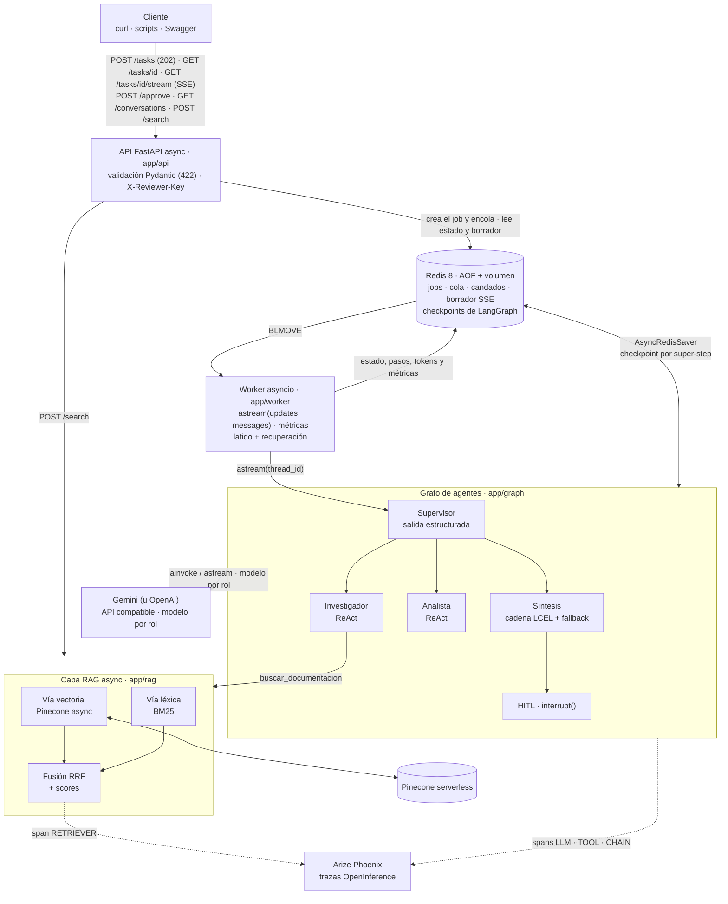

# Entrega final: Sistema Intelligence de grado de producción

**En cinco minutos, para un ingeniero senior:** es un servicio que responde preguntas técnicas sobre
**Caudal** (una librería ficticia de ingesta de datos; su documentación es el corpus) combinando
**documentación** y **cálculo**. Un **supervisor** de LangGraph decide paso a paso a quién delegar: un
**investigador** que consulta una capa **RAG híbrida** (Pinecone + BM25 fusionados con RRF), un **analista**
con una calculadora segura y una **síntesis** que redacta con las fuentes citadas. Todo corre **async** detrás
de una **API FastAPI** que responde `202` al instante y encola el trabajo en **Redis**; un worker ejecuta el
grafo con un **checkpointer de Redis**, así las conversaciones y las tareas pausadas sobreviven a reinicios.
Las acciones con efectos afuera (publicar un reporte) se **pausan hasta que un revisor autenticado las
aprueba**. Cada corrida deja una **traza en Arize Phoenix** y cada respuesta trae sus **fuentes, latencia,
tokens y costo**. El progreso (y el texto de la respuesta mientras se escribe) se puede seguir **en vivo por SSE**.

## Para corregir en 3 minutos

```bash
cp .env.example .env                 # completá OPENAI_API_KEY (Gemini u OpenAI) y PINECONE_API_KEY
python3 -c "import secrets; print(secrets.token_urlsafe(24))"   # pegala como clave de "ana" en REVIEWER_KEYS
docker compose up --build -d --wait  # Redis + Phoenix + API; en una cuenta de Pinecone nueva crea el índice y sube el corpus
curl -s localhost:8000/health        # {"status":"ok", ..., "aprobacion":"protegida"}
uv run python -m scripts.pruebas_e2e # (opcional) las pruebas reales; las trazas quedan en http://localhost:6006
```

| criterio de la rúbrica | dónde mirarlo |
|---|---|
| Arquitectura y coherencia (30 %) | [diagrama](#2-arquitectura) · [grafo de agentes](#3-grafo-de-agentes) · [de dónde sale cada capa](#2-arquitectura) |
| Async + Pydantic (25 %) | [sección 15](#15-async-pydantic-y-funciones-avanzadas-de-langgraphlangchain) · [`tests/test_estandares.py`](tests/test_estandares.py) (ni `requests` ni `time.sleep` en `app/`) |
| Checkpointer + trazas (20 %) | [conversaciones y reinicio](#9-conversaciones-persistentes-y-reinicio) · [observabilidad](#12-observabilidad-trazas-y-métricas-por-respuesta) · [`screenshots/`](screenshots/) |
| README + despliegue (15 %) | este bloque · [paso a paso](#6-cómo-levantarlo-paso-a-paso) · [`docker-compose.yml`](docker-compose.yml) · [`run.sh`](run.sh) |
| Entorno y estándares (10 %) | [variables](#7-variables-de-entorno) · [`.env.example`](.env.example) · `pyproject.toml` + `uv.lock` (Python 3.12) |

El resto del `.env.example` ya tiene valores que funcionan (índice `sistema-intelligence`, Gemini gratis con un
modelo por rol). Si quedó algún `<...>` sin completar, la API no arranca y el log dice qué variable falta. El
arranque real en una cuenta de Pinecone sin el índice está en [`docs/arranque_limpio.md`](docs/arranque_limpio.md).

Tabla completa criterio → código → evidencia en la [sección 17](#17-criterio--dónde-se-cumple); las decisiones
de diseño, con sus alternativas, en la [sección 16](#16-decisiones-de-arquitectura-adr).

> **Resultado de las pruebas reales** (24/10/2026, Gemini free tier + Pinecone, API en Docker): 5 escenarios
> `DONE` + 1 de contratos (422, 404, 401), todos con trazas en Phoenix. Pregunta con RAG + cálculo seguida **en
> vivo por SSE** (el texto transmitido es idéntico a la respuesta final); seguimiento en la misma conversación
> en 45 s **sin volver a buscar**; tarea crítica que **siguió pausada después de `docker compose restart api
> redis`** y se aprobó **sin repetir ninguna llamada al LLM**; turno 3 de la conversación respondido después de
> otro reinicio con el historial del checkpoint. Gemini devolvió dos 503 de "alta demanda" en la prueba 01: la
> `RetryPolicy` los reintentó y la traza los muestra. Costo y tokens de la API **coinciden exactamente** con
> Phoenix. `uv run pytest -q` → **229 passed**.

---

## Índice

1. [Qué resuelve](#1-qué-resuelve)
2. [Arquitectura](#2-arquitectura)
3. [Grafo de agentes](#3-grafo-de-agentes)
4. [Estructura del repo](#4-estructura-del-repo)
5. [Requisitos](#5-requisitos)
6. [Cómo levantarlo (paso a paso)](#6-cómo-levantarlo-paso-a-paso)
7. [Variables de entorno](#7-variables-de-entorno)
8. [Cómo usar la API (con respuestas reales)](#8-cómo-usar-la-api-con-respuestas-reales)
9. [Conversaciones persistentes y reinicio](#9-conversaciones-persistentes-y-reinicio)
10. [Human-in-the-loop](#10-human-in-the-loop)
11. [Capa RAG](#11-capa-rag)
12. [Observabilidad: trazas y métricas por respuesta](#12-observabilidad-trazas-y-métricas-por-respuesta)
13. [Las pruebas del sistema (reales, con trazas)](#13-las-pruebas-del-sistema-reales-con-trazas)
14. [Tests automáticos](#14-tests-automáticos)
15. [Async, Pydantic y funciones avanzadas de LangGraph/LangChain](#15-async-pydantic-y-funciones-avanzadas-de-langgraphlangchain)
16. [Decisiones de arquitectura (ADR)](#16-decisiones-de-arquitectura-adr)
17. [Criterio → dónde se cumple](#17-criterio--dónde-se-cumple)
18. [Devoluciones anteriores incorporadas](#18-devoluciones-anteriores-incorporadas)

---

## 1. Qué resuelve

Un equipo que opera pipelines con Caudal necesita respuestas que combinan **documentación** y
**cuentas**: "¿qué tamaño de lote se recomienda para ingesta masiva y cuánto tarda procesar 2 millones de
eventos con 4 workers?". Hoy eso es buscar en varios documentos, copiar números y hacer la cuenta a mano.

El sistema lo resuelve como una **tarea compleja de varios pasos**:

| paso | quién | qué usa |
|---|---|---|
| 1. entender la pregunta (y la conversación previa) y planificar | Supervisor | LLM con salida estructurada Pydantic + rúbrica de validación |
| 2. buscar los datos con su fuente | Investigador | **RAG híbrido** (Pinecone + BM25) |
| 3. calcular con esos datos | Analista | calculadora AST segura + estimador validado con Pydantic |
| 4. validar (cobertura, evidencia, cálculos, consistencia) y redactar | Supervisor + Síntesis | rúbrica + LLM |
| 5. si pide publicar: pausar hasta que un humano apruebe | HITL | `interrupt()` + `POST /approve` |

Y lo expone como un servicio: cualquier cliente (una persona con `curl`, un bot, otro sistema) manda la
tarea, recibe un `job_id` al instante, consulta el estado, puede seguir la conversación con el mismo
`thread_id` y ve de dónde salió cada dato, cuánto tardó y cuánto costó.

## 2. Arquitectura



**De dónde sale cada capa** (todo el código vive en este repo; nada se importa de otras carpetas):

| capa | carpeta | viene de | qué cambió para la final |
|---|---|---|---|
| Cliente LLM | `app/core/providers.py` | PE1 (cliente async con streaming, reintentos y latencia) | `ChatOpenAI` async contra cualquier endpoint compatible, **modelo por rol**, limitador de RPM por modelo, timeouts y caídas de red **reintentables**, thought signatures de Gemini, **streaming de tokens** en la síntesis (`stream_usage` para no perder el costo) |
| Cadenas LCEL | `app/agents/synthesizer.py` | PE2 (cadena con contrato de datos y `with_retry`) | la síntesis es `ChatPromptTemplate \| modelo.with_fallbacks([...]) \| StrOutputParser \| validar → RespuestaFinal` con `with_retry`; el supervisor usa `with_structured_output` |
| Configuración | `app/core/config.py` | PE5, PE7 | **un solo** `Settings` (pydantic-settings): keys `SecretStr`, sin índices ni modelos en el código |
| RAG | `app/rag/` | PE3, PE4 | **100 % async** (`AsyncPinecone` + `aembed_query`), fusión RRF propia que **devuelve scores**, `BaseRetriever` con span RETRIEVER, **ingesta automática** al arrancar |
| Agentes | `app/agents/` | PE5, PE6 | herramientas con `args_schema` + salida Pydantic (`content_and_artifact`), supervisor que ve la conversación previa y detecta fuera de dominio |
| Grafo | `app/graph/` | PE5, PE6, PE7 | **memoria por `thread_id`** (historial + reinicio del turno con `Overwrite`), nodo `cerrar_turno`, HITL con el valor de reanudación validado |
| Worker y jobs | `app/worker/` | PE7 | jobs y mensajes de la cola validados con Pydantic, **candado por conversación**, **pasos y tokens para el SSE**, **varios workers sin doble ejecución** |
| API | `app/api/` | PE7 | rutas separadas, `response_model` en todo, `GET /conversations/{thread_id}`, `POST /search`, **`GET /tasks/{id}/stream`**, **revisores autenticados** |
| Observabilidad | `app/observability/` | PE7 | callback de métricas (tokens, costo, latencia) que coincide con Phoenix |

**Por qué así:**

- **Ningún endpoint espera al grafo.** Solo leen y escriben Redis (`redis.asyncio`) y encolan: `POST /tasks`
  tarda ~10 ms aunque la corrida tarde minutos (la cuota gratis de Gemini obliga a espaciar pedidos).
- **La cola y el estado viven en Redis**, no en memoria: un reinicio no pierde jobs, conversaciones ni
  pausas. `BLMOVE` + lista `procesando` dan entrega "al menos una vez" y el checkpoint permite continuar.
- **Composición en un solo lugar** (`recursos_desde_settings` en `app/main.py`): trazas → Redis →
  checkpointer → RAG (con ingesta si hace falta) → modelos → grafo → worker. La app recibe la fábrica por parámetro
  (`create_app(fabrica)`), así los tests le pasan fakes sin red.

## 3. Grafo de agentes

Diagrama generado del **grafo real** con `draw_mermaid()` (`uv run python -m scripts.exportar_grafo`,
también en [`docs/grafo.mmd`](docs/grafo.mmd)); las flechas punteadas son aristas condicionales:


| nodo | qué hace | detalle |
|---|---|---|
| `supervisor` | decide quién sigue con `SupervisorDecision` (Pydantic): `researcher`, `analyst` o `FINISH`, con una instrucción autocontenida y una **rúbrica** (cobertura, evidencia, cálculos, consistencia) | ve los últimos 3 turnos de la conversación; marca `fuera_de_dominio` si la pregunta no es sobre Caudal; tope de 6 pasos (`MAX_STEPS`) |
| `researcher` | agente ReAct con **una** herramienta: `buscar_documentacion` → capa RAG | recibe solo la instrucción (aislamiento de contexto); cita `[doc › sección]` |
| `analyst` | agente ReAct con `calcular` (AST, sin `eval`) y `estimar_tiempo_procesamiento` | recibe la instrucción + los hallazgos del investigador del turno (o la respuesta previa, si es un seguimiento) |
| `synthesizer` | redacta la respuesta con las contribuciones | si es fuera de dominio responde un mensaje fijo **sin LLM** |
| `evaluar_criticidad` | criterio determinista: `publicar: true` o un **pedido** de publicar/enviar/notificar/exportar ("publicá el reporte", no "¿qué exporta Caudal?") | los motivos quedan en el estado y en la traza |
| `aprobacion_humana` | `interrupt()`: pausa hasta `POST /approve`; devuelve `Command(goto=...)` | no tiene efectos antes del `interrupt()` (al reanudar se re-ejecuta) |
| `publicar_reporte` | el efecto secundario: deja el reporte en Redis | solo se llega aprobado |
| `cerrar_turno` | agrega el `Turno` al historial de la conversación | única salida a `END`: todos los caminos registran el turno |

## 4. Estructura del repo

```
├── app/
│   ├── main.py                 # create_app + composición (recursos_desde_settings)
│   ├── api/                    # routes_tasks (+ stream SSE), routes_conversations, routes_search, routes_system,
│   │                           # schemas, deps (revisores)
│   ├── core/                   # config (pydantic-settings), providers (modelo por rol, Gemini), logging
│   ├── rag/                    # corpus (chunking), retriever (Pinecone async + BM25 + RRF), ingesta (automática), schemas
│   ├── agents/                 # supervisor, researcher, analyst, synthesizer (cadena LCEL), tool_schemas, common
│   ├── graph/                  # state (turno + conversación), builder, hitl, checkpointer (AsyncRedisSaver)
│   ├── worker/                 # models (JobRecord, mensajes de la cola), jobs (Redis), worker (latido, astream)
│   └── observability/          # tracing (Phoenix/OpenInference), metricas (tokens, costo, latencia)
├── data/                       # corpus: documentación de Caudal (7 documentos, 21 chunks)
├── scripts/                    # ingest, probar_modelos, exportar_grafo, pruebas_e2e, phoenix_report,
│                               # capturas, evidencia_redis.sh
├── tests/                      # tests sin red (fakeredis, InMemorySaver, LLM y RAG fake) + 2 con Redis real (sección 14)
├── examples/                   # pedidos y respuestas REALES de las pruebas end-to-end (JSON)
├── docs/                       # resultados de las pruebas, reporte de Phoenix, evidencia de Redis, ingesta, grafo
├── screenshots/                # capturas de Phoenix y de la API
├── docker-compose.yml          # Redis + Phoenix + API con healthchecks (una sola instrucción)
├── Dockerfile · run.sh         # imagen de la API · alternativa con la API local
├── pyproject.toml · uv.lock · requirements.txt · .python-version (3.12)
└── .env.example                # todas las variables, con placeholders
```

## 5. Requisitos

- **Docker** con Compose v2 (Docker Desktop). Es lo único necesario para la opción A.
- Para la opción B y los scripts: **[uv](https://docs.astral.sh/uv/)** (instala Python 3.12 solo si hace falta).
- Una **key de Gemini** (gratis en Google AI Studio) o de OpenAI, y una **key de Pinecone** (plan gratuito).
- Nada más: si el índice de Pinecone no existe (o está vacío), la API lo crea y sube el corpus al arrancar.

## 6. Cómo levantarlo (paso a paso)

**1. Clonar y configurar**

```bash
git clone <url-del-repo> && cd <repo>
cp .env.example .env        # completá OPENAI_API_KEY, PINECONE_API_KEY y la clave de REVIEWER_KEYS
```

**2A. Opción recomendada: todo en Docker con una sola instrucción**

```bash
docker compose up --build            # agregá -d para dejarlo en segundo plano
```

Levanta `redis` (`redis:8.10.2` con AOF), `phoenix` y `api`, en ese orden: la API espera a que Redis y Phoenix
estén *healthy* (`depends_on: condition: service_healthy`) y tiene su propio healthcheck sobre `/health`.
Al arrancar, la API arma el índice BM25 (21 chunks), se conecta a Pinecone de forma asíncrona y, si el
índice no existe o está vacío, lo crea y lo carga (por eso el healthcheck de la API tiene `start_period: 180s`).

**2B. Alternativa: Redis y Phoenix en Docker, la API local (para desarrollar)**

```bash
./run.sh                              # docker compose up -d --wait redis phoenix + uv sync + uvicorn
```

**3. El índice de Pinecone: automático**

No hace falta ningún paso manual. Al arrancar, la API se fija si `INDEX_NAME` existe y si su namespace
tiene vectores (`preparar_indice`, `app/rag/ingesta.py`): en una cuenta de Pinecone nueva **crea el índice
serverless y sube los 21 chunks** de `data/` antes de aceptar pedidos; si ya están cargados no gasta ni un
embedding. Se puede apagar con `RAG_AUTO_INGESTA=false` y hacer la ingesta a mano:

```bash
uv run python -m scripts.ingest --solo-indice   # crea el índice si falta y cuenta vectores (sin embeddings)
uv run python -m scripts.ingest                 # sube los 21 chunks; idempotente (mismos ids: no duplica)
```

Salida real de la ingesta manual en [`docs/ingesta.txt`](docs/ingesta.txt).

**4. Verificar**

```bash
curl -s localhost:8000/health
# {"status":"ok","redis":"ok","version":"1.0.0","modelos":{"supervisor":"gemini-flash-lite-latest",
#  "research":"gemini-3.5-flash-lite","analyst":"gemini-3.1-flash-lite","synth":"gemini-3.1-flash-lite",
#  "synth_fallback":"gemini-flash-lite-latest"},"rag":{"indice":"pre-entrega-4","namespace":"caudal-docs",
#  "chunks_bm25":21},"trazas":"entrega-final","worker_concurrencia":5,"aprobacion":"protegida","revisores":1}
```

- Swagger: <http://localhost:8000/docs> ([captura](screenshots/09_api_swagger.png)) · Phoenix: <http://localhost:6006>
- Probar que los modelos responden (1 pedido por modelo): `uv run python -m scripts.probar_modelos`
- Apagar: `docker compose down` (los volúmenes `redis-data` y `phoenix-data` quedan; `down -v` los borra).

## 7. Variables de entorno

Todas se leen en un solo lugar (`app/core/config.py`, `Settings` de pydantic-settings) y están en
[`.env.example`](.env.example). Las **obligatorias** no tienen valor por defecto en el código: si falta
una, la API no arranca y el error dice cuál (`tests/test_config.py`). Ningún nombre de modelo ni de índice
está escrito en `app/`: lo controla `tests/test_estandares.py` sobre cada archivo.

| variable | obligatoria | para qué | ejemplo / default |
|---|---|---|---|
| `OPENAI_API_KEY` | sí | key de Gemini u OpenAI (`SecretStr`, nunca se loguea) | — |
| `OPENAI_BASE_URL` | no | endpoint compatible con OpenAI; vacío = OpenAI | `https://generativelanguage.googleapis.com/v1beta/openai/` |
| `OPENAI_MODEL` | sí | modelo por defecto de todos los roles | `gemini-flash-lite-latest` |
| `SUPERVISOR_MODEL` · `RESEARCH_MODEL` · `ANALYST_MODEL` · `SYNTH_MODEL` | no | modelo por rol (reparte la cuota gratis, que es por modelo) | `OPENAI_MODEL` |
| `SYNTH_FALLBACK_MODEL` | no | alternativo de la síntesis si el principal falla (429, 5xx, timeout) | sin fallback |
| `LLM_RPM` · `LLM_TIMEOUT_S` | no | pedidos por minuto **por modelo** (limitador) · segundos máximos por pedido (un timeout se reintenta) | sin límite (el `.env.example` trae `4`, para el free tier) · `90` |
| `SUPERVISOR_STRUCTURED_METHOD` | no | `json_schema` · `function_calling` · `json_mode` | `json_schema` |
| `PRECIOS_LLM` | no | JSON con US$/1M tokens por modelo para el costo estimado (un modelo sin precio queda en `modelos_sin_precio`) | la tabla de Phoenix, en el `.env.example` |
| `EMBEDDING_MODEL` | sí | modelo de embeddings (el de la ingesta) | `gemini-embedding-001` |
| `EMBEDDING_DIMENSION` | no | dimensión del índice | `1536` |
| `PINECONE_API_KEY` | sí | key de Pinecone | — |
| `INDEX_NAME` | sí | índice serverless (si no existe, se crea al arrancar) | `sistema-intelligence` (o `pre-entrega-4` para reusar el de la PE4) |
| `PINECONE_NAMESPACE` | sí | namespace del corpus | `caudal-docs` |
| `PINECONE_CLOUD` · `PINECONE_REGION` | no | dónde crear el índice si no existe | `aws` · `us-east-1` |
| `RAG_TOP_K` · `RAG_PESO_VECTOR` | no | fragmentos por búsqueda · peso del vector en RRF | `5` · `0.5` |
| `RAG_AUTO_INGESTA` | no | al arrancar, crea el índice y sube el corpus si falta o está vacío (máquina limpia) | `true` |
| `REVIEWER_KEYS` | para aprobar | revisores y sus claves en JSON (`{"ana": "<clave>"}`, 16+ caracteres): `POST /approve` exige `X-Reviewer-Key` y registra el nombre del dueño | sin revisores = **nadie** aprueba (503) |
| `REDIS_URL` | no | jobs, cola y checkpoints (el compose la pisa con `redis://redis:6379/0`) | `redis://localhost:6379/0` |
| `REDIS_PREFIJO` · `JOB_TTL_S` | no | prefijo de claves · vencimiento del estado de los jobs (los checkpoints no vencen) | `final` · `604800` (7 días) |
| `WORKER_CONCURRENCY` · `WORKER_EMBEBIDO` | no | jobs a la vez · `0` = la API solo encola (`python -m app.worker`) | `5` · `1` |
| `MAX_STEPS` · `TURNOS_DE_CONTEXTO` | no | pasos del supervisor por turno · turnos previos que ve | `6` · `3` |
| `PHOENIX_COLLECTOR_ENDPOINT` | no | colector OTLP (el compose la pisa con `http://phoenix:6006/v1/traces`) | `http://localhost:6006/v1/traces` |
| `PHOENIX_PROJECT_NAME` · `TRACING_ENABLED` | no | proyecto en Phoenix · `0` apaga las trazas | `entrega-final` · `1` |
| `LOG_LEVEL` | no | nivel de logs | `INFO` |

## 8. Cómo usar la API (con respuestas reales)

| método y ruta | qué hace | códigos |
|---|---|---|
| `POST /tasks` | crea un turno (con o sin `thread_id`) y lo encola | **202**, 409 (conversación ocupada), 422 |
| `GET /tasks/{job_id}` | estado, resultado (respuesta, **fuentes**, contribuciones), **métricas** y los **pasos** del grafo | 200, 404, 422 |
| `GET /tasks/{job_id}/stream` | **progreso en vivo por SSE**: estados, cada nodo del grafo que termina y los **tokens** de la respuesta mientras se escribe | 200, 404, 422 |
| `GET /tasks` | últimos jobs | 200 |
| `POST /tasks/{job_id}/approve` | aprueba o rechaza una tarea crítica pausada; exige `X-Reviewer-Key` (el revisor sale de la clave) | **202**, 401, 404, 409, 422, 503 (sin revisores) |
| `GET /conversations/{thread_id}` | historial de la conversación, leído del checkpoint | 200, 404, 422 |
| `POST /search` | búsqueda directa en la capa RAG | 200, 422, 503 |
| `GET /health` | Redis responde, grafo y RAG cargados, modelos por rol, si la aprobación está protegida | 200, 503 |

Todos los pedidos y respuestas de esta sección son **reales** (24/10/2026) y están completos en [`examples/`](examples/).

**Una tarea que necesita RAG + cálculo** ([`examples/01_rag_y_calculo.json`](examples/01_rag_y_calculo.json)):

```bash
curl -s -X POST localhost:8000/tasks -H 'content-type: application/json' -d '{
  "pregunta": "Según la documentación de Caudal, ¿qué tamaño de lote se recomienda para ingesta masiva? ¿Cuántos lotes son 2.000.000 de eventos con ese tamaño y cuánto tarda procesarlos con 4 workers que procesan 5 lotes por segundo cada uno?",
  "thread_id": "e2e-conversacion-final-10241141"}'
# 202 en 5,0 ms: {"job_id":"0e35dc6fb25b47c2ae39aad9639015d7","thread_id":"e2e-conversacion-final-10241141","status":"PENDING",...}

curl -N localhost:8000/tasks/0e35dc6fb25b47c2ae39aad9639015d7/stream     # progreso en vivo (SSE)
```

Lo que llegó por el stream ([captura 15](screenshots/15_stream_sse_prueba_01.png)):

```text
event: estado  data: {"status":"PENDING", ...}                                        0,0 s
event: estado  data: {"status":"RUNNING", ...}                                        0,0 s
event: nodo    data: {"nodo":"supervisor","detalle":"-> researcher: Se necesita buscar en la documentación..."}   24,1 s
event: nodo    data: {"nodo":"researcher","detalle":"ok, 5 fuentes"}                  154,1 s  (incluye dos 503 reintentados)
event: nodo    data: {"nodo":"supervisor","detalle":"-> analyst: El researcher ya encontró el tamaño de lote..."} 158,7 s
event: nodo    data: {"nodo":"analyst","detalle":"ok, 1 fuentes"}                     192,1 s
event: nodo    data: {"nodo":"supervisor","detalle":"-> synthesizer: Todos los criterios de la rúbrica..."}        196,9 s
event: token   data: {"texto":"Para la ingesta masiva en Caudal, se recomienda un tamaño de lote de **5.000..."}  205,7 s
event: nodo    data: {"nodo":"synthesizer"} · {"nodo":"evaluar_criticidad"} · {"nodo":"cerrar_turno"}               206,2 s
event: estado  data: {"status":"DONE", ...}
event: fin     data: {... el JobRecord completo: respuesta, fuentes, métricas ...}
```

`GET /tasks/{id}` (extracto; [captura 10](screenshots/10_respuesta_api_fuentes_y_metricas.png)):

```json
{
  "status": "DONE",
  "resultado": {
    "respuesta": "Para la ingesta masiva en Caudal, se recomienda un tamaño de lote de **5.000 eventos o más** [caudal-rendimiento › Backpressure y tamaño de lote]. ... **Cantidad de lotes:** 400 lotes. Cálculo: 2.000.000 eventos / 5.000 eventos por lote = 400 lotes. **Tiempo de procesamiento:** 20 segundos. Cálculo: 400 lotes / (5 lotes por segundo por worker * 4 workers) = 400 / 20 = 20 segundos.",
    "fuentes": [
      {"doc_id": "caudal-rendimiento", "seccion": "Backpressure y tamaño de lote", "chunk_id": "caudal-rendimiento-p2-c0",
       "score": 0.016393, "score_vector": 0.696471, "score_bm25": 10.423878, "recuperado_por": ["vector", "bm25"]},
      {"doc_id": "caudal-conectores", "seccion": "ConectorPostgres: fuente y sumidero de base de datos", "score": 0.015505, "...": "..."}
    ],
    "contribuciones": [{"agente": "researcher", "herramientas": ["buscar_documentacion"], "...": "..."},
                       {"agente": "analyst", "herramientas": ["estimar_tiempo_procesamiento"], "...": "..."}],
    "ruta_supervisor": ["researcher", "analyst", "FINISH"],
    "turno": 1
  },
  "metricas": {
    "latencia_total_s": 206.075, "llamadas_llm": 10, "tokens_entrada": 15282, "tokens_salida": 1879,
    "costo_estimado_usd": 0.00754165,
    "por_modelo": {"gemini-flash-lite-latest": {"llamadas": 3, "...": "..."}, "gemini-3.5-flash-lite": {"llamadas": 4, "...": "..."},
                   "gemini-3.1-flash-lite": {"llamadas": 3, "...": "..."}}
  },
  "pasos": [{"nodo": "supervisor", "t": "...", "detalle": "-> researcher: ..."}, "..."]
}
```

Mientras ese job corría, otro turno en la **misma** conversación se rechazó (no pueden pisarse el checkpoint):

```json
409 {"detail": "La conversación e2e-conversacion-final-10241141 tiene un job en curso (0e35dc6fb25b47c2ae39aad9639015d7). Esperá a que termine (o aprobalo) y volvé a enviar."}
```

**Pregunta de seguimiento** en la misma conversación
([`examples/02_seguimiento_misma_conversacion.json`](examples/02_seguimiento_misma_conversacion.json)):

```bash
curl -s -X POST localhost:8000/tasks -H 'content-type: application/json' \
  -d '{"pregunta": "¿Y si en vez de 4 workers uso 8, cuánto tardaría?", "thread_id": "e2e-conversacion-final-10241141"}'
```

El supervisor leyó el turno anterior del checkpoint y fue **directo al analista**, sin volver a buscar
(`ruta_supervisor: ["analyst", "FINISH"]`, 5 llamadas al LLM, 45 s):

> Si utilizas 8 workers, el tiempo de procesamiento sería de **10 segundos**. ... Cálculo: 400 lotes / (5 lotes
> por segundo por worker * 8 workers) = 10 segundos.

**Historial de la conversación** (después de 3 turnos y de un reinicio):

```bash
curl -s localhost:8000/conversations/e2e-conversacion-final-10241141
# {"thread_id":"e2e-conversacion-final-10241141",
#  "turnos":[{"numero":1,"pregunta":"Según la documentación de Caudal, ¿qué tamaño de lote se recomienda...", "fuentes":[...]},
#            {"numero":2,"pregunta":"¿Y si en vez de 4 workers uso 8, cuánto tardaría?", ...},
#            {"numero":3,"pregunta":"Resumime en dos líneas el tamaño de lote recomendado y los dos tiempos...", ...}],
#  "jobs":["0e35dc6f...","d1437cce...","36d8def1..."],"job_activo":null,"pausado_en":[],"mensajes":15,"checkpoints":47}
```

**Búsqueda directa en el RAG** (sin agentes, sin LLM de chat):

```bash
curl -s -X POST localhost:8000/search -H 'content-type: application/json' -d '{"consulta": "¿Qué significa el error CAU-417?", "k": 3}'
# {"modo":"hibrido","fragmentos":[
#   {"chunk_id":"caudal-errores-p1-c0","seccion":"Códigos de error CAU","score":0.016393,"score_vector":0.71046,"score_bm25":3.461209,"recuperado_por":["vector","bm25"], "contenido": "..."},
#   {"chunk_id":"caudal-errores-p2-c0","seccion":"Reintentos y cola de errores", ...}, ...], "latencia_ms": 2155.9}
```

<details>
<summary><b>Validación y errores (422, 404, 401)</b>: <a href="examples/06_validacion_y_errores.json"><code>examples/06_validacion_y_errores.json</code></a></summary>

```json
POST /tasks {"pregunta": "corta"}
422 {"detail":[{"type":"string_too_short","loc":["body","pregunta"],"msg":"String should have at least 10 characters","input":"corta","ctx":{"min_length":10}}]}

POST /tasks {"pregunta": "¿Cuál es el tamano_lote por defecto?", "prioridad": "alta"}
422 {"detail":[{"type":"extra_forbidden","loc":["body","prioridad"],"msg":"Extra inputs are not permitted","input":"alta"}]}

POST /tasks/000.../approve  (X-Reviewer-Key: una-clave-que-no-es-de-nadie)
401 {"detail":"Falta la clave de revisor o no es válida (header X-Reviewer-Key)."}

POST /tasks/000.../approve {"aprobado": true, "revisor": "yo"}
422 (extra_forbidden: el revisor sale de la clave, no del body)
```

Los 11 pedidos y sus códigos: 6 × 422 (`pregunta` corta, `publicar` no booleano, `thread_id` fuera del patrón
`^[A-Za-z0-9_-]{4,64}$`, campo desconocido, `k` fuera de 1..10 en `/search`, `job_id` que no es hex de 32), 2 × 404,
401, 422 del body de aprobación y 200 de la búsqueda.

</details>

## 9. Conversaciones persistentes y reinicio

- **Un job es un turno; un `thread_id` es una conversación.** Sin `thread_id`, `POST /tasks` abre una
  conversación nueva y devuelve su id. Con el mismo `thread_id`, el grafo arranca sobre el estado guardado
  en Redis bajo ese hilo.
- **Qué se acumula y qué se reinicia** (`app/graph/state.py`): `messages` (reducer `add_messages`) e
  `historial` (reducer `operator.add`, un `Turno` por pregunta) se acumulan. Lo del turno se reinicia en
  `entrada_turno` (`app/graph/state.py`); `contributions` y `decisiones` tienen reducer acumulativo, así
  que se reinician con `Overwrite([])`, que **saltea el reducer**.
- **El supervisor y la síntesis ven los últimos 3 turnos** (`render_historial` en `app/agents/supervisor.py`);
  el analista recibe la respuesta previa si en el turno no hubo investigación nueva.
- **Candado por conversación** (`JobStore._tomar_candado` en `app/worker/jobs.py`): dos turnos del mismo hilo no corren a la vez
  (409). Se libera al terminar (DONE/FAILED); un turno fallido no contamina el siguiente: la entrada nueva
  descarta las tareas pendientes del checkpoint (`tests/test_conversations.py`).
- **Sobrevive a reinicios**: Redis corre con AOF (`--appendonly yes` en `docker-compose.yml`) y un volumen.

**Demo de reinicio** (prueba 03, automatizada en `scripts/pruebas_e2e.py`; el reinicio antes de la 03b se hizo a
mano, ver [`docs/pruebas_e2e.md`](docs/pruebas_e2e.md)):

1. La tarea crítica `4b6e1c6c` quedó en `WAITING_APPROVAL` con 5 llamadas al LLM.
2. `docker compose restart api redis` → la API volvió a responder `/health` en 5,2 s.
3. `GET /tasks/4b6e1c6c...` → **sigue en `WAITING_APPROVAL`**; la conversación tiene los mismos turnos.
4. `POST /approve` → `DONE` y publicado, con **5 llamadas al LLM en total: las mismas 5 de antes de la pausa**.
   La reanudación salió del checkpoint en Redis, no repitió el trabajo (en Phoenix, la traza `reanudar` tiene
   0 llamadas al LLM).
5. Con la conversación `e2e-conversacion-final-10241141` en 2 turnos y 41 checkpoints, otro
   `docker compose restart api redis`: después del reinicio seguía con 2 turnos y 41 checkpoints. El turno 3
   (`03b`) respondió usando los turnos 1 y 2 (ruta `["FINISH"]`: no hizo falta buscar ni calcular, 2 llamadas
   al LLM, [captura 12](screenshots/12_traza_03b_turno_despues_del_reinicio.png)):

> El tamaño de lote recomendado para ingesta masiva es de 5.000 eventos o más [caudal-rendimiento › Backpressure
> y tamaño de lote]. Con 4 workers el procesamiento tarda 20 segundos, mientras que con 8 workers el tiempo se
> reduce a 10 segundos.

Evidencia en Redis ([`docs/redis_evidencia.md`](docs/redis_evidencia.md)): `aof_enabled:1`, índices
`checkpoint` y `checkpoint_write`, **47 checkpoints** del hilo de 3 turnos, la lista de sus 3 jobs, el
candado liberado y el historial de eventos del job crítico. En Phoenix, cada conversación es una **sesión**
con sus turnos ([captura 05](screenshots/05_sesion_conversacion_thread_id.png)).

## 10. Human-in-the-loop

Una tarea es **crítica** si implica una acción con efectos fuera del sistema: publicar el reporte. Se
detecta de forma determinista (`motivos_criticidad` en `app/graph/hitl.py`): `"publicar": true` en el
body, o un **pedido** en la pregunta, en formas que no se confunden con una pregunta: voseo con tilde ("publicá",
"mandá"), imperativo con pronombre ("publicalo"), "quiero que envíes", "publica **el reporte**" o una orden en
infinitivo al principio ("Notificar al canal..."). "¿Qué métricas exporta Caudal?" o "¿cómo es la publicación de
eventos?" **no** son críticas (`tests/test_hitl.py`, 16 casos). No lo decide el LLM: así no se lo puede
"convencer" de saltear la aprobación.

```bash
# Prueba 03: la pregunta pide publicar → WAITING_APPROVAL con lo que hay que revisar
curl -s localhost:8000/tasks/<job_id>
# "aprobacion_pendiente": {"accion": "publicar_reporte",
#   "motivos": ["La pregunta pide una acción hacia afuera ('publica'): se ejecutaría 'publicar_reporte'."],
#   "borrador": "...", "como_responder": "POST /tasks/{job_id}/approve con el header X-Reviewer-Key y {...}"}

curl -s -X POST localhost:8000/tasks/<job_id>/approve -H 'content-type: application/json' \
  -H "X-Reviewer-Key: <clave de ana en REVIEWER_KEYS>" \
  -d '{"aprobado": true, "comentario": "Revisado: las fuentes están citadas."}'
# 202 → DONE con "reporte_publicado": "final:reporte:<job_id>" y "aprobacion": {"revisor": "ana", ...}
# sin el header o con otra clave → 401 y el job sigue en WAITING_APPROVAL
# sin REVIEWER_KEYS configuradas → 503: la aprobación está deshabilitada, nunca abierta
```

- **Quién aprueba (seguro por defecto):** `REVIEWER_KEYS` asocia cada clave a un revisor
  (`{"ana": "<clave>"}`). `requiere_revisor` (`app/api/deps.py`) compara contra todas con
  `secrets.compare_digest` (tiempo constante) y devuelve el **nombre del dueño**: eso es lo que queda
  registrado, no un campo del body (mandar `"revisor"` da 422). Sin revisores configurados nadie puede
  aprobar (503) y `/health` dice `"aprobacion": "deshabilitada"`. En Swagger aparece el botón **Authorize**.
- **El valor de reanudación también se valida**: el nodo `aprobacion_humana` pasa lo que llega por
  `Command(resume=...)` por `DecisionHumana` antes de usarlo.

- **Aprobada** ([`examples/03_hitl_aprobada_con_reinicio.json`](examples/03_hitl_aprobada_con_reinicio.json)):
  `PENDING → RUNNING → WAITING_APPROVAL → PENDING → RUNNING → DONE`, reporte publicado en Redis.
- **Rechazada** ([`examples/04_hitl_rechazada.json`](examples/04_hitl_rechazada.json)): la respuesta empieza con
  *"La acción 'publicar_reporte' fue RECHAZADA por revisión humana (comentario: Falta la versión mínima de
  cada conector.). El reporte NO se publicó..."*; una segunda aprobación del mismo job da **409**.
- La transición `WAITING_APPROVAL → PENDING` es atómica (WATCH/MULTI): dos aprobaciones simultáneas no
  reanudan dos veces (`tests/test_hitl.py`).
- En Phoenix la pausa queda como evento `Interrupt` del span `aprobacion_humana`
  ([captura 04](screenshots/04_hitl_pausa_interrupt.png)).

## 11. Capa RAG

`app/rag/retriever.py`:

1. **Vía semántica async**: `aembed_query` (Gemini `gemini-embedding-001`, 1536 dim.) + `AsyncIndex.query`
   del SDK de Pinecone 10 (cliente asíncrono nativo sobre httpx). Sin hilos.
2. **Vía léxica**: BM25 en memoria sobre los **mismos** chunks (ids deterministas `doc-pN-cM`), con un
   tokenizador en español que conserva códigos como `cau-417` y `tamano_lote`.
3. Las dos vías corren a la vez (`asyncio.gather`) y se fusionan con **RRF** (`fusionar_rrf` en
   `app/rag/retriever.py`): `score = Σ peso / (60 + posición)`. Cada resultado conserva su score RRF,
   el coseno de Pinecone y el puntaje BM25, y por qué vía llegó.
4. El recuperador es un `BaseRetriever` de LangChain: llamado con `ainvoke` deja un **span RETRIEVER** en
   Phoenix con la consulta y los documentos ([captura 03](screenshots/03_span_rag_fuentes_scores.png)).

5. **Ingesta automática** (`preparar_indice` en `app/rag/ingesta.py`): al arrancar, si el índice no existe
   o su namespace está vacío, se crea el índice serverless y se suben los chunks (`aembed_documents` +
   `upsert` con ids deterministas, idempotente). Compara los vectores con los chunks de `data/`: una ingesta que
   quedó a medias se completa; si ya están todos, no se gasta ni un embedding. Arranque real en una cuenta sin el
   índice: [`docs/arranque_limpio.md`](docs/arranque_limpio.md).

La herramienta del investigador le pasa al modelo el texto **completo** de cada fragmento con su etiqueta
`doc › sección`, y guarda la salida completa (con scores) como *artifact*: de ahí salen las `fuentes` de
la respuesta de la API, sin parsear texto. `POST /search` usa exactamente el mismo servicio y el mismo
esquema (`ConsultaRAG` → `ResultadoBusqueda`).

## 12. Observabilidad: trazas y métricas por respuesta

**Trazas** (`app/observability/tracing.py`): `phoenix.otel.register` + `LangChainInstrumentor` de
OpenInference. Cada corrida del grafo es una traza `orquestador job=<id> (ejecutar|reanudar)` con un span
por nodo, por llamada al LLM (modelo, tokens, costo), por herramienta y por recuperación. La metadata lleva
`thread_id`, `job_id` y `fase`; OpenInference usa el `thread_id` como `session.id`, así **cada conversación
es una sesión** en Phoenix. La telemetría HTTP nativa de FastAPI está apagada para que el polling no tape
las trazas que importan (`create_app` en `app/main.py`).

**Métricas por respuesta** (`app/observability/metricas.py`): un callback de LangChain (`MetricasLLM`) que
el worker pasa en el `config` de cada corrida cuenta llamadas y tokens por modelo (de `usage_metadata`)
en **todos** los modelos que se llaman adentro, incluidos los agentes ReAct. Con la tabla de precios de
Phoenix (`PRECIOS_LLM`) estima el costo. `GET /tasks/{id}` devuelve `latencia_total_s` (POST → DONE),
`latencia_ejecucion_s`, `espera_aprobacion_s`, `llamadas_llm`, tokens, `costo_estimado_usd` y el detalle
`por_modelo`, acumulando corrida inicial y reanudación.

Las llamadas que fallan (un 429 o un 503 que la `RetryPolicy` reintenta) no suman tokens ni costo; la API las
cuenta aparte en `llamadas_fallidas` y en Phoenix quedan como spans LLM en ERROR. (El campo se agregó justo después
de la corrida del 24/10, al investigar la diferencia de la prueba 01: por eso los `examples/` todavía no lo traen;
lo cubre `tests/test_metricas.py` y la columna de Phoenix de abajo muestra los dos 503.)

**Control cruzado** ([`docs/phoenix_report.md`](docs/phoenix_report.md), `uv run python -m scripts.phoenix_report`):
lo que reporta la API coincide con lo que calcula Phoenix para el mismo job.

| prueba | costo API (US$) | costo Phoenix (US$) | tokens API | tokens Phoenix | LLM API (ok) | LLM Phoenix (ok + en ERROR) |
|---|---|---|---|---|---|---|
| 01 RAG + cálculo | 0,00754165 | 0,007542 | 15282/1879 | 15282/1879 | 10 | 10 + 2 (los 503 reintentados) |
| 02 seguimiento | 0,0031928 | 0,003193 | 7299/648 | 7299/648 | 5 | 5 + 0 |
| 03 HITL aprobada + reinicio | 0,0047451 | 0,004745 | 8838/1264 | 8838/1264 | 5 | 5 + 0 |
| 03b turno después del reinicio | 0,00164695 | 0,001647 | 3944/321 | 3944/321 | 2 | 2 + 0 |
| 04 HITL rechazada | 0,0063605 | 0,006360 | 13806/1325 | 13806/1325 | 6 | 6 + 0 |
| 05 fuera de dominio | 0,0004984 | 0,000498 | 703/115 | 703/115 | 1 | 1 + 0 |

**Capturas** (Phoenix 20.21.1, tomadas con `scripts/capturas.py` y Chromium headless; cada una busca su traza por
el `job_id` de la metadata, así muestra la corrida que dice mostrar). La 08, la 10 y la 15 no son la UI de Phoenix
sino páginas HTML que arma el script con datos reales (el reporte de Phoenix, la respuesta de `GET /tasks/{id}` y
los eventos SSE que recibió la prueba 01):

| captura | qué muestra |
|---|---|
| [01_trazas_lista](screenshots/01_trazas_lista.png) | las trazas del proyecto `entrega-final`: corridas del orquestador (ejecutar / reanudar), búsquedas directas y la corrida que falló por el 503 |
| [02_traza_rag_y_calculo](screenshots/02_traza_rag_y_calculo.png) | **prueba 01** abierta: supervisor → researcher (con los 503 reintentados marcados) → … y la entrada del turno (`__overwrite__`) |
| [03_span_rag_fuentes_scores](screenshots/03_span_rag_fuentes_scores.png) | el span **RETRIEVER** `recuperacion_hibrida` dentro de `buscar_documentacion`: consulta y documentos |
| [04_hitl_pausa_interrupt](screenshots/04_hitl_pausa_interrupt.png) | **prueba 03**: el span `aprobacion_humana` con el evento `Interrupt` (la pausa) |
| [05_sesion_conversacion_thread_id](screenshots/05_sesion_conversacion_thread_id.png) | la **sesión** de la conversación de las pruebas 01, 02 y 03b: sus turnos, tokens y latencia |
| [06_span_llm_tokens_costo](screenshots/06_span_llm_tokens_costo.png) | un span LLM: modelo, tokens, costo y el prompt |
| [07_metricas_costo_latencia](screenshots/07_metricas_costo_latencia.png) | pestaña *Metrics*: volumen, percentiles de latencia, costo y top de modelos |
| [08_costo_por_traza_y_control_cruzado](screenshots/08_costo_por_traza_y_control_cruzado.png) | costo exacto por traza y la tabla API vs. Phoenix (la UI redondea a "<$0.01") |
| [09_api_swagger](screenshots/09_api_swagger.png) | la API documentada en `/docs` |
| [10_respuesta_api_fuentes_y_metricas](screenshots/10_respuesta_api_fuentes_y_metricas.png) | `GET /tasks/{id}` real de la prueba 01: respuesta, fuentes con scores y métricas |
| [11_traza_02_seguimiento](screenshots/11_traza_02_seguimiento.png) | **prueba 02**: el supervisor va directo al analista (sin investigador) |
| [12_traza_03b_turno_despues_del_reinicio](screenshots/12_traza_03b_turno_despues_del_reinicio.png) | **prueba 03b**: el turno 3 después del reinicio, sin buscar ni calcular |
| [13_traza_04_rechazada](screenshots/13_traza_04_rechazada.png) | **prueba 04**: la reanudación con la decisión de rechazo |
| [14_traza_05_fuera_de_dominio](screenshots/14_traza_05_fuera_de_dominio.png) | **prueba 05**: supervisor → síntesis sin LLM (0 ms) |
| [15_stream_sse_prueba_01](screenshots/15_stream_sse_prueba_01.png) | **el stream SSE de la prueba 01**: estados, nodos con su detalle y los tokens de la respuesta, con el segundo de cada evento |

## 13. Las pruebas del sistema (reales, con trazas)

Se corrieron contra la API en Docker con `uv run python -m scripts.pruebas_e2e` (en serie, por la cuota gratis
de Gemini) el 24/10/2026. Resumen en [`docs/pruebas_e2e.md`](docs/pruebas_e2e.md); pedidos y respuestas en
[`examples/`](examples/).

| # | prueba | estados | ruta del supervisor | fuentes | LLM | tokens in/out | costo est. | latencia |
|---|---|---|---|---|---|---|---|---|
| 01 | RAG + cálculo, seguida por **SSE** (abre la conversación) | `PENDING → RUNNING → DONE` | researcher → analyst → FINISH | 5 | 10 | 15282/1879 | US$ 0,0075 | 206,1 s |
| 02 | seguimiento, mismo `thread_id` | `PENDING → RUNNING → DONE` | analyst → FINISH | 0 | 5 | 7299/648 | US$ 0,0032 | 45,3 s |
| 03 | tarea crítica **aprobada**, con `docker compose restart api redis` en medio | `… → WAITING_APPROVAL → PENDING → RUNNING → DONE` | researcher → FINISH | 5 | 5 | 8838/1264 | US$ 0,0047 | 44,6 s (6,3 s de espera humana) |
| 03b | turno 3 de la conversación, después de otro reinicio | `PENDING → RUNNING → DONE` | FINISH | 0 | 2 | 3944/321 | US$ 0,0016 | 37,6 s |
| 04 | tarea crítica **rechazada** (y 409 a una segunda aprobación) | `… → WAITING_APPROVAL → PENDING → RUNNING → DONE` | researcher → FINISH | 7 | 6 | 13806/1325 | US$ 0,0064 | 63,3 s |
| 05 | **fuera de dominio** ("¿Quién ganó el Mundial 2022?") | `PENDING → RUNNING → DONE` | FINISH | 0 | 1 | 703/115 | US$ 0,0005 | 6,5 s |
| 06 | contratos: 6 × 422, 2 × 404, 401, 422 del body de aprobación, búsqueda 200 | — | — | — | 0 | — | — | — |

- La latencia la domina la **cuota**, no el modelo: con `LLM_RPM=4` cada modelo admite un pedido cada 15 s.
  Una llamada sola tarda 1-6 s (`scripts/probar_modelos.py`). Con una cuota paga, bajar ese límite baja la
  latencia casi linealmente.
- **Dos corridas** (detalle en [`docs/pruebas_e2e.md`](docs/pruebas_e2e.md)): 03, 04, 05 y 06 son de la primera;
  01, 02 y 03b, de la segunda, en una conversación nueva, porque en la primera la 01 había quedado `FAILED`.
- **La prueba 01 atravesó dos 503** ("This model is currently experiencing high demand") del modelo del
  investigador: la `RetryPolicy` reintentó con espera y el job terminó bien (130 s de esos 206 son el
  investigador, reintentos incluidos). En una corrida anterior el mismo 503 duró más que los 3 intentos de
  entonces y el job quedó `FAILED` con el motivo: por eso hoy son 4 intentos (20, 40 y 80 s). Esa traza fallida
  también está en Phoenix.
- El investigador y la síntesis son los que más tokens consumen (los fragmentos vuelven a entrar al modelo en cada
  vuelta del ReAct y en la síntesis; ver la tabla por nodo en [`docs/phoenix_report.md`](docs/phoenix_report.md)).

## 14. Tests automáticos

```bash
uv run pytest -q          # 229 passed (sin red: fakeredis, InMemorySaver, LLM y RAG fake)
                          # los 2 de tests/test_redis_checkpoint.py usan un Redis real si hay uno en :6379
                          # (docker compose up -d redis); sin Redis: 227 passed + 2 skipped
uv run ruff check . && uv run ruff format --check .
```

<details>
<summary><b>Qué prueba cada archivo</b></summary>

| archivo | tests | qué prueba |
|---|---|---|
| `tests/test_api.py` | 21 | **202 sin bloquear** (< 0,5 s con el grafo corriendo); `PENDING → RUNNING → DONE`; excepción → **FAILED** con el error y el worker sigue vivo; 5 jobs en paralelo; **422** para bodies y paths inválidos; 404; mensajes de un worker caído reencolados; **un worker que arranca no le roba mensajes a otro vivo**; **un mensaje reentregado de un job terminado no lo vuelve a correr**; `/health` 503 con contrato si Redis no responde; OpenAPI documentado |
| `tests/test_stream.py` | 7 | **SSE**: los pasos del grafo quedan en el job; el stream trae estados y nodos en orden y se cierra al terminar o en la pausa; **los tokens de la síntesis llegan antes de que termine el nodo** y forman exactamente la respuesta; un reintento que escribe más texto igual dispara `reinicio`; OpenAPI documenta los cinco eventos |
| `tests/test_sintesis.py` | 5 | la síntesis es una **cadena LCEL** que devuelve `RespuestaFinal` con sus citas; respuesta vacía → `with_retry`; 429 del principal → **responde el fallback**; un error que no es transitorio no usa el fallback |
| `tests/test_conversations.py` | 4 | **seguimiento con el mismo `thread_id` usa el historial**; el turno se reinicia (`Overwrite`); la conversación sobrevive a "reiniciar" la API; 409 por conversación ocupada; un turno FAILED no contamina el siguiente |
| `tests/test_hitl.py` | 28 | criterio de criticidad (16 casos, con las preguntas informativas que no deben pausar); pausa, **aprobar** → publica una vez; **rechazar** → no publica y lo explica; 409 por doble aprobación; 422 del body; **401 sin clave o con una equivocada, el revisor sale de la clave, 503 sin revisores**; otro worker reanuda **sin llamar a ningún LLM** |
| `tests/test_tools.py` | 35 | **`args_schema` Pydantic** rechaza argumentos inválidos antes de ejecutar; el agente recibe el error y corrige; **salidas tipadas** vía artifact; calculadora AST contra código malicioso, **overflow, resultados desmesurados y complejos** |
| `tests/test_rag.py` | 15 | BM25 sobre el corpus real; matemática de RRF; recuperador async y su **span RETRIEVER**; `POST /search`; la respuesta de un job trae las fuentes; ingesta idempotente; **ingesta automática** (índice inexistente, vacío, a medias o ya cargado; dos procesos creándolo a la vez) |
| `tests/test_estandares.py` | 77 | sobre **cada archivo de `app/`**: ni `requests` ni `time.sleep`, y ningún literal que sea un id de modelo o de índice |
| `tests/test_graph.py` | 10 | rutas del supervisor, contribuciones con fuentes, aislamiento de contexto, rúbrica, tope de pasos, fuera de dominio sin LLM, diagrama del grafo real |
| `tests/test_config.py` · `tests/test_providers.py` | 20 | sin variables obligatorias no arranca y dice cuáles; **los `<...>` del `.env.example` sin completar tampoco**, y el `.env.example` completado es válido; nombre de índice con el patrón de Pinecone; keys secretas; `REVIEWER_KEYS`; `RAG_TOP_K` y `ConsultaRAG` comparten el límite; modelo por rol; **solo la síntesis hace streaming**; limitador por modelo; thought signatures; **timeouts y caídas de red se reintentan**, la cuota diaria no |
| `tests/test_metricas.py` | 5 | el callback cuenta tokens por modelo y estima el costo; **las llamadas que fallan se cuentan aparte**; suma corrida + reanudación |
| `tests/test_redis_checkpoint.py` | 2 | contra **Redis real** (`AsyncRedisSaver`): la pausa HITL se reanuda con otra instancia; `Overwrite` se serializa bien |

</details>

## 15. Async, Pydantic y funciones avanzadas de LangGraph/LangChain

**Todo async, sin `requests` ni `time.sleep`** (lo verifica `tests/test_estandares.py` en cada archivo de `app/`):

| capa | cómo |
|---|---|
| API | endpoints `async def`; Redis con `redis.asyncio` (`JobStore`, `app/worker/jobs.py`); SSE con un generador async (`_eventos_sse`) |
| worker | consumidores `asyncio` con `BLMOVE` (`Worker._consumir`) y `graph.astream(stream_mode=["updates", "messages"])` (`Worker.procesar`) |
| LLM | `ChatOpenAI` async (cliente `AsyncOpenAI` sobre httpx) en todos los nodos; la síntesis con `astream` de tokens |
| Pinecone | `AsyncPinecone` / `AsyncIndex` del SDK 10 y `aembed_query` (`PineconeBusquedaVectorial`); vector y BM25 en paralelo con `asyncio.gather` (`RecuperadorHibrido`) |
| checkpointer | `AsyncRedisSaver` (`redis_checkpointer`, `app/graph/checkpointer.py`) |
| scripts | ingesta, pruebas end-to-end, reporte de Phoenix y capturas con `asyncio` + `httpx.AsyncClient` |

Lo único que corre en un hilo (`asyncio.to_thread`) es lo que no tiene versión async y bloquearía el loop:
el chunking del corpus al arrancar (archivos + tiktoken), el `force_flush` de OpenTelemetry al apagar y la
escritura de archivos de los scripts. BM25 sobre 21 chunks es cálculo en memoria de microsegundos.

**Pydantic en todas las entradas y salidas:**

| qué | modelo |
|---|---|
| configuración | `Settings` (pydantic-settings, `SecretStr`, rangos, `REVIEWER_KEYS` validadas) · `app/core/config.py` |
| bodies de la API | `TareaIn` (`extra="forbid"`, `StrictBool`, patrón de `thread_id`) · `DecisionIn` · `ConsultaRAG` |
| respuestas de la API | `response_model` en cada ruta: `TareaAceptada`, `JobRecord` (con `EventoEstado` y `EventoNodo`), `AprobacionAceptada`, `ConversacionOut`, `ResultadoBusqueda`, `HealthOut`, `ErrorOut` |
| herramientas | `args_schema`: `ArgsBusqueda`, `ArgsCalculo`, `ParametrosEstimacion`; salidas: `SalidaBusqueda`, `SalidaCalculo`, `SalidaEstimacion`, `ErrorHerramienta` · `app/agents/tool_schemas.py` |
| salidas de los LLM | `SupervisorDecision` + `Rubrica` (salida estructurada) · `RespuestaFinal` (la cadena de síntesis) |
| HITL | `DecisionHumana` valida también el valor de `Command(resume=...)` dentro del grafo |
| jobs y cola | `JobRecord`, `ResultadoTarea`, `Fuente`, `Metricas`; unión discriminada `MensajeEjecutar \| MensajeReanudar` al leer de Redis |

El estado del grafo es un `TypedDict` de valores simples porque se serializa en cada checkpoint; Pydantic
valida en los **bordes** (lo que entra y sale de la API, de las herramientas, de los LLM y de la cola).

<details>
<summary><b>Funciones avanzadas usadas</b> (lo que pidió la devolución de la PE6)</summary>


| función | dónde | para qué |
|---|---|---|
| `interrupt()` + `Command(resume=...)` | `aprobacion_humana` (`app/graph/hitl.py`), `Worker.procesar` | pausar y reanudar desde el checkpoint |
| `Command(goto=..., update=...)` | `aprobacion_humana` | rutear y actualizar el estado en un solo retorno |
| `Overwrite` | `entrada_turno` (`app/graph/state.py`) | reiniciar un canal con reducer acumulativo al empezar cada turno |
| `astream(stream_mode=["updates", "messages"])` | `Worker.procesar` | pasos del grafo y tokens del modelo para el SSE |
| LCEL: `ChatPromptTemplate \| modelo \| StrOutputParser \| RunnableLambda` | `build_cadena_sintesis` | la síntesis como cadena con contrato de salida |
| `with_fallbacks` · `with_retry` | `build_cadena_sintesis` | otro modelo si el principal falla; reintento si la respuesta sale vacía |
| `with_structured_output` | `build_decider` (`app/agents/supervisor.py`) | decisión del supervisor validada con Pydantic |
| `AsyncRedisSaver` + `aget_state` / `aget_state_history` | `redis_checkpointer`, `ver_conversacion` | persistencia, historial y conteo de checkpoints |
| `RetryPolicy` por nodo | `RETRY_MODELO` (`app/agents/common.py`), `build_graph` | reintentar 429 por minuto, 5xx, timeouts y caídas de red; no la cuota diaria |
| `@tool(args_schema=..., response_format="content_and_artifact")` | `crear_herramienta_busqueda`, `calcular`, `estimar_tiempo_procesamiento` | args validados y salida tipada sin pasarle todo al modelo |
| `BaseRetriever` propio | `RecuperadorHibrido` (`app/rag/retriever.py`) | span RETRIEVER en Phoenix con los documentos |
| callback de LangChain | `MetricasLLM` (`app/observability/metricas.py`) | tokens y costo por respuesta en todos los modelos anidados |
| `InMemoryRateLimiter` por modelo | `_rate_limiter` (`app/core/providers.py`) | no pasarse de la cuota por minuto del free tier |
| `draw_mermaid()` | `scripts/exportar_grafo.py` | el diagrama del README es el del grafo real |

</details>

## 16. Decisiones de arquitectura (ADR)

Cada decisión con el contexto, las alternativas que se descartaron y lo que cuesta.

**ADR-1 · Cola propia sobre Redis en vez de Celery/Arq.** *Contexto:* el grafo ya es async y Redis ya está
(checkpoints). *Alternativas:* Celery (síncrono por diseño, un broker más), Arq (async, pero otra abstracción
sobre la misma Redis). *Decisión:* `LPUSH` + `BLMOVE` a una lista `procesando` **por worker**, con una señal de
vida que vence a los 30 s; los mensajes de un worker caído se reencolan y el checkpoint permite continuar. Un
mensaje reentregado de un job que ya terminó se descarta (`mensaje_vigente`). *Costo:* entrega "al menos una vez"
(un job interrumpido se reanuda); sin prioridades ni reintento automático de un
job `FAILED`.

**ADR-2 · `AsyncRedisSaver` en vez de Postgres o SQLite.** *Alternativas:* `AsyncPostgresSaver` (mejor para
consultar historia con SQL), `AsyncSqliteSaver` (un archivo, no sirve con varios procesos). *Decisión:* Redis,
porque ya es la cola y el estado de los jobs: un servicio menos, AOF para durabilidad. *Costo:* necesita los
módulos JSON y Search (`redis:8.10.2`); los checkpoints no vencen (habría que agregar TTL para conversaciones viejas).

**ADR-3 · Polling + SSE en vez de WebSocket.** *Contexto:* el cliente necesita seguir un job que tarda minutos.
*Alternativas:* WebSocket (bidireccional, pero no hace falta mandar nada mientras corre), webhooks (el
cliente necesita un endpoint público). *Decisión:* `GET /tasks/{id}` para polling simple y `GET /tasks/{id}/stream`
(SSE: HTTP común, se prueba con `curl -N`, un cliente de navegador es un `EventSource`). El stream lee los eventos
y el borrador del job en Redis cada 250 ms, así funciona con cualquier cantidad de workers y de réplicas de la API.
*Costo:* una lectura de Redis por cliente conectado cada 250 ms; no hay `id:` por evento ni `Last-Event-ID`, así que
quien se reconecta recibe todo desde el principio (el cliente cierra al recibir `fin`). Con muchos clientes o
reconexiones conviene Redis Streams (`XREAD BLOCK`) con ids.

**ADR-4 · Streaming de tokens solo en la síntesis.** *Contexto:* Gemini exige devolver la *thought signature*
de cada tool call, y el rescate de ese campo está en la ruta sin streaming. *Decisión:* los agentes con
herramientas no transmiten; la síntesis (sin herramientas, y es el texto que lee el usuario) sí, con
`stream_usage=True` para que el costo se siga contando. *Costo:* durante la investigación el cliente ve los
pasos, no texto.

**ADR-5 · Criterio de criticidad determinista y revisores por clave.** *Alternativas:* que el LLM decida si
una tarea es crítica (manipulable con la pregunta), OAuth/JWT (más infraestructura que la que pide el
alcance). *Decisión:* reglas fijas (`publicar: true` o un pedido explícito) y `REVIEWER_KEYS` con el nombre de cada
revisor; sin revisores, la aprobación está **deshabilitada** (seguro por defecto). *Costo:* las claves se
rotan cambiando el `.env`; el resto de la API no tiene autenticación ni límite por cliente.

**ADR-6 · Gemini gratis por el endpoint compatible con OpenAI, un modelo por rol.** *Contexto:* la cuota
gratis es ~20 pedidos por día y ~5 por minuto **por modelo**. *Decisión:* `ChatOpenAI` contra
`OPENAI_BASE_URL` (cambiar a OpenAI es cambiar el `.env`), un modelo distinto por rol, `LLM_RPM` por modelo y
un `SYNTH_FALLBACK_MODEL`. *Costo:* las pruebas corren en serie y la latencia la domina la cuota (sección 13);
el limitador es por proceso.

**ADR-7 · BM25 en memoria, construido desde `data/` en cada proceso.** *Alternativas:* búsqueda léxica en el
propio Pinecone (sparse vectors) u OpenSearch. *Decisión:* 21 chunks no justifican otro servicio; el BM25 y la
ingesta de Pinecone salen del **mismo** `load_chunks` con los mismos ids, así las dos vías no se desincronizan.
*Costo:* si el corpus creciera mucho, se duplica en memoria por proceso y habría que pasar a sparse vectors.

**ADR-8 · `create_react_agent` para los especialistas.** Está marcado como deprecado en LangGraph 1.x a favor de
`langchain.agents.create_agent`; se mantiene porque es la API que se usó en el curso y está cubierta por los
tests. *Próximo paso:* migrar, junto con una evaluación automática de respuestas (golden set de la PE4 con
LLM-as-judge en Phoenix) y TTL para los checkpoints de conversaciones viejas.

## 17. Criterio → dónde se cumple

Las referencias son a funciones y clases (no a números de línea, que cambian con cada commit).

| criterio (peso) | dónde se cumple | evidencia |
|---|---|---|
| **1. Arquitectura y coherencia del sistema (30 %)**: LLMs + RAG + agentes en un flujo unificado | composición única `recursos_desde_settings` (`app/main.py`): trazas → Redis → checkpointer → RAG → modelos → grafo → worker; `build_graph` (`app/graph/builder.py`); el investigador usa la capa RAG (`crear_herramienta_busqueda`); lo de M1 (`build_model`, streaming) y M2 (`build_cadena_sintesis`, LCEL) adentro; fuentes del RAG en la respuesta (`resumen_resultado`); memoria por `thread_id` (`OrchestratorState`, `entrada_turno`); HITL (`aprobacion_humana`); SSE (`stream_tarea`) | diagramas de las secciones 2 y 3; pruebas 01-05 en [docs/pruebas_e2e.md](docs/pruebas_e2e.md); capturas de las trazas; `tests/test_rag.py`, `tests/test_sintesis.py`, `tests/test_stream.py` |
| **2. Robustez técnica: asincronía y validación (25 %)** | async de punta a punta (sección 15); Pydantic en API, herramientas, LLM, HITL, cola y configuración (sección 15); reintentos de 429/5xx/timeouts (`es_error_transitorio`); calculadora acotada (`evaluar_expresion`); varios workers sin doble ejecución (`Worker.recuperar`) | `tests/test_estandares.py` (77, uno por archivo); `tests/test_api.py` (202 sin bloquear, 422, FAILED, recuperación); `tests/test_tools.py`; [examples/06](examples/06_validacion_y_errores.json) (422, 404, 401 reales) |
| **3. Persistencia y observabilidad (20 %)**: checkpointers y trazado externo | `AsyncRedisSaver` (`redis_checkpointer`) + `compile(checkpointer=...)` + `thread_id` en `run_config`; reanudación con `Command(resume=...)`; Redis con AOF y volumen; trazas OpenInference (`init_tracing`); métricas por respuesta (`MetricasLLM`) | demo de reinicio (sección 9) y [docs/redis_evidencia.md](docs/redis_evidencia.md); `tests/test_conversations.py`, `tests/test_redis_checkpoint.py`; una traza abierta por prueba en [`screenshots/`](screenshots/); control cruzado API = Phoenix (sección 12) |
| **4. Documentación y despliegue (15 %)** | este README (3 minutos para corregir, diagramas, paso a paso, variables, ejemplos reales, ADR); `docker-compose.yml` con healthchecks y `depends_on: service_healthy`; ingesta automática; `run.sh`; `Dockerfile` sin root | [`docs/arranque_limpio.md`](docs/arranque_limpio.md): clone desde GitHub + `.env.example` con solo las keys + `docker compose up --build -d --wait` en una cuenta de Pinecone sin el índice → la API lo crea, sube el corpus y responde; [captura de Swagger](screenshots/09_api_swagger.png); [examples/](examples/) |
| **5. Configuración de entorno y estándares de código (10 %)** | Python 3.12 (`requires-python`, `.python-version`, imagen `python:3.12.15-slim`; `redis:8.10.2` fijo); `uv.lock` + `requirements.txt` (sin dependencias de desarrollo); un solo `Settings` sin IDs ni modelos en el código; `.env.example` con todas las variables; type hints; `ruff` | `tests/test_config.py`, `tests/test_estandares.py`; `ruff check` y `ruff format --check` sin errores; ninguna key en el historial de git; `.env` en `.gitignore` |

## 18. Devoluciones anteriores incorporadas

| devolución | qué se hizo |
|---|---|
| PE6: "completar las secciones que quedaron vacías" | README sin secciones vacías; cada sección con evidencia real |
| PE6: "agregar más ejemplos" | [`examples/`](examples/) con los pedidos y respuestas reales de cada prueba; ejemplos de curl con salida real en la sección 8 |
| PE6: "revisar el README para incluir instrucciones de ejecución" | bloque "Para corregir en 3 minutos" y sección 6 paso a paso |
| PE6: "explorar funciones avanzadas de la biblioteca usada" | `Overwrite`, `interrupt`/`Command`, `astream` con dos modos, LCEL con `with_fallbacks`/`with_retry`, `RetryPolicy`, `content_and_artifact`, `BaseRetriever` propio, callbacks (sección 15) |
| PE1: "explorar nuevos proveedores" | proveedor intercambiable por `OPENAI_BASE_URL` (Gemini u OpenAI), modelo por rol, fallback a otro modelo |
| PE1: "métricas de latencia y conteo de tokens en las respuestas" | bloque `metricas` en cada `GET /tasks/{id}`: latencias, tokens, llamadas y costo por modelo, verificado contra Phoenix |
