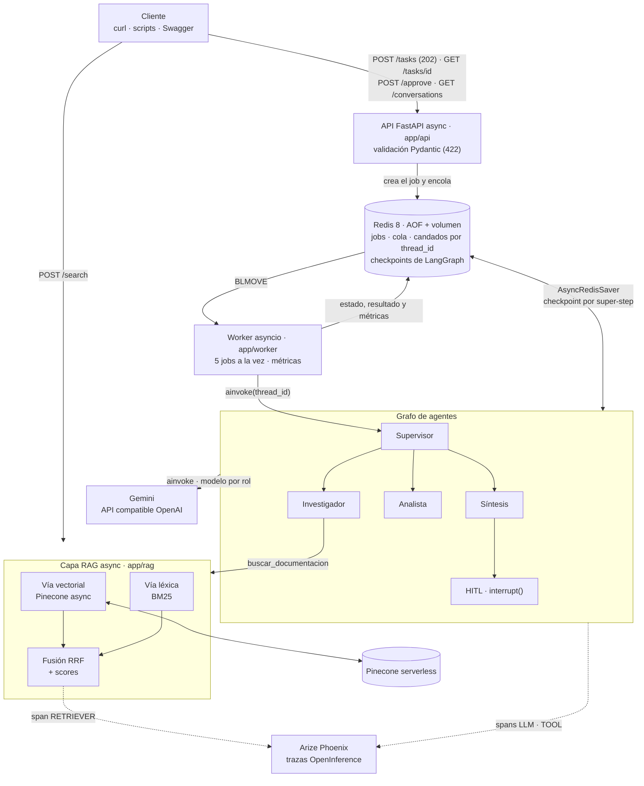
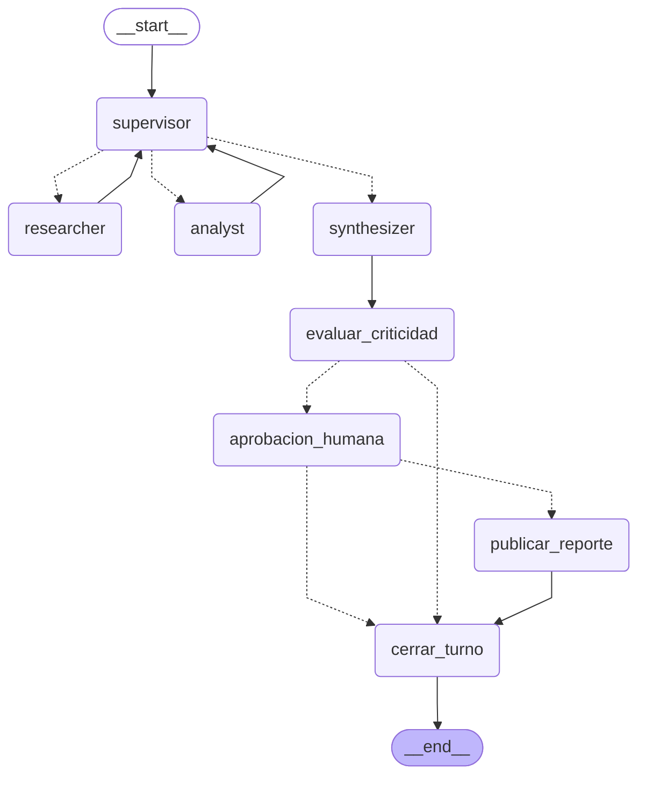

# Entrega final: Sistema Intelligence de grado de producción

Sistema de IA de punta a punta que responde preguntas técnicas sobre **Caudal** (una librería ficticia
de ingesta de datos cuya documentación es el corpus del curso) y hace cálculos de capacidad con esos
datos. Integra en un solo flujo lo construido en las pre-entregas:

- **RAG híbrido** (PE4): Pinecone (semántico) + BM25 (léxico) fusionados con RRF, **todo async**.
  Cada respuesta trae sus `fuentes` (documento, sección, chunk y scores).
- **Agentes con Supervisor** (PE6): un supervisor con salida estructurada Pydantic delega en un
  investigador (usa el RAG), un analista (calculadora segura) y una síntesis.
- **API profesional** (PE7): FastAPI asíncrona; `POST /tasks` responde `202` en milisegundos y el grafo
  corre en un worker con cola en Redis. Swagger en `/docs`, validación Pydantic en cada entrada y salida.
- **Persistencia**: checkpointer `AsyncRedisSaver` de LangGraph. Las **conversaciones** (por `thread_id`)
  y las tareas pausadas **sobreviven a reiniciar la API y Redis**.
- **Human-in-the-loop**: las tareas que publican un reporte se pausan con `interrupt()` hasta
  `POST /tasks/{id}/approve`.
- **Trazabilidad completa**: cada corrida es una traza en **Arize Phoenix** (OpenInference), con un span
  propio de la capa RAG, y cada respuesta de la API trae sus **métricas** (latencia, tokens y costo).

> **Resultado de las pruebas reales** (15/10/2026, Gemini free tier + Pinecone, API en Docker): 6 jobs
> `DONE` + 1 prueba de contratos, todas con trazas en Phoenix. Pregunta con RAG + cálculo en 113 s y
> US$ 0,0052 estimados; seguimiento en la misma conversación en 35 s **sin volver a buscar**; tarea crítica
> pausada que **siguió pausada después de `docker compose restart api redis`** y se aprobó sin repetir
> ninguna llamada al LLM. El costo y los tokens que devuelve la API **coinciden exactamente** con los de
> Phoenix. `uv run pytest -q` → **103 passed**.

---

## Índice

1. [Qué resuelve](#1-qué-resuelve)
2. [Arquitectura](#2-arquitectura)
3. [Grafo de agentes](#3-grafo-de-agentes)
4. [Estructura del repo](#4-estructura-del-repo)
5. [Requisitos](#5-requisitos)
6. [Cómo levantarlo (paso a paso)](#6-cómo-levantarlo-paso-a-paso)
7. [Variables de entorno](#7-variables-de-entorno)
8. [Cómo usar la API (con respuestas reales)](#8-cómo-usar-la-api-con-respuestas-reales)
9. [Conversaciones persistentes y reinicio](#9-conversaciones-persistentes-y-reinicio)
10. [Human-in-the-loop](#10-human-in-the-loop)
11. [Capa RAG](#11-capa-rag)
12. [Observabilidad: trazas y métricas por respuesta](#12-observabilidad-trazas-y-métricas-por-respuesta)
13. [Las pruebas del sistema (reales, con trazas)](#13-las-pruebas-del-sistema-reales-con-trazas)
14. [Tests automáticos](#14-tests-automáticos)
15. [Async, Pydantic y funciones avanzadas de LangGraph/LangChain](#15-async-pydantic-y-funciones-avanzadas-de-langgraphlangchain)
16. [Decisiones, límites y próximos pasos](#16-decisiones-límites-y-próximos-pasos)
17. [Criterio → dónde se cumple](#17-criterio--dónde-se-cumple)
18. [Devoluciones anteriores incorporadas](#18-devoluciones-anteriores-incorporadas)

---

## 1. Qué resuelve

Un equipo que opera pipelines con Caudal necesita respuestas que combinan **documentación** y
**cuentas**: "¿qué tamaño de lote se recomienda para ingesta masiva y cuánto tarda procesar 2 millones de
eventos con 4 workers?". Hoy eso es buscar en varios documentos, copiar números y hacer la cuenta a mano.

El sistema lo resuelve como una **tarea compleja de varios pasos**:

| paso | quién | qué usa |
|---|---|---|
| 1. entender la pregunta (y la conversación previa) y planificar | Supervisor | LLM con salida estructurada Pydantic + rúbrica de validación |
| 2. buscar los datos con su fuente | Investigador | **RAG híbrido** (Pinecone + BM25) |
| 3. calcular con esos datos | Analista | calculadora AST segura + estimador validado con Pydantic |
| 4. validar (cobertura, evidencia, cálculos, consistencia) y redactar | Supervisor + Síntesis | rúbrica + LLM |
| 5. si pide publicar: pausar hasta que un humano apruebe | HITL | `interrupt()` + `POST /approve` |

Y lo expone como un servicio: cualquier cliente (una persona con `curl`, un bot, otro sistema) manda la
tarea, recibe un `job_id` al instante, consulta el estado, puede seguir la conversación con el mismo
`thread_id` y ve de dónde salió cada dato, cuánto tardó y cuánto costó.

## 2. Arquitectura



**De dónde sale cada capa** (todo el código vive en este repo; nada se importa de otras carpetas):

| capa | carpeta | viene de | qué cambió para la final |
|---|---|---|---|
| LLM y proveedores | `app/core/` | PE1, PE5 | `Settings` con pydantic-settings, modelo por rol, limitador de RPM por modelo, thought signatures de Gemini |
| RAG | `app/rag/` | PE4 | **100 % async** (Pinecone 10 `AsyncPinecone` + `aembed_query`), fusión RRF propia que **devuelve scores**, `BaseRetriever` con span RETRIEVER, ingesta async idempotente |
| Agentes | `app/agents/` | PE6 | herramientas con `args_schema` + salida Pydantic (`content_and_artifact`), supervisor que ve la conversación previa y detecta fuera de dominio |
| Grafo | `app/graph/` | PE6, PE7 | **memoria por `thread_id`** (historial + reinicio del turno con `Overwrite`), nodo `cerrar_turno`, HITL |
| Worker y jobs | `app/worker/` | PE7 | jobs y mensajes de la cola validados con Pydantic, **candado por conversación**, **métricas por respuesta** |
| API | `app/api/` | PE7 | rutas separadas, `response_model` en todo, `GET /conversations/{thread_id}`, `POST /search` |
| Observabilidad | `app/observability/` | PE7 | callback de métricas (tokens, costo, latencia) que coincide con Phoenix |

**Por qué así:**

- **Ningún endpoint espera al grafo.** Solo leen y escriben Redis (`redis.asyncio`) y encolan: `POST /tasks`
  tarda ~10 ms aunque la corrida tarde minutos (la cuota gratis de Gemini obliga a espaciar pedidos).
- **La cola y el estado viven en Redis**, no en memoria: un reinicio no pierde jobs, conversaciones ni
  pausas. `BLMOVE` + lista `procesando` dan entrega "al menos una vez" y el checkpoint permite continuar.
- **Composición en un solo lugar** (`app/main.py:34`, `recursos_desde_settings`): trazas → Redis →
  checkpointer → RAG → modelos → grafo → worker. La app recibe la fábrica por parámetro
  (`create_app(fabrica)`), así los tests le pasan fakes sin red.

## 3. Grafo de agentes

Diagrama generado del **grafo real** con `draw_mermaid()` (`uv run python -m scripts.exportar_grafo`,
también en [`docs/grafo.mmd`](docs/grafo.mmd)); las flechas punteadas son aristas condicionales:



| nodo | qué hace | detalle |
|---|---|---|
| `supervisor` | decide quién sigue con `SupervisorDecision` (Pydantic): `researcher`, `analyst` o `FINISH`, con una instrucción autocontenida y una **rúbrica** (cobertura, evidencia, cálculos, consistencia) | ve los últimos 3 turnos de la conversación; marca `fuera_de_dominio` si la pregunta no es sobre Caudal; tope de 6 pasos (`MAX_STEPS`) |
| `researcher` | agente ReAct con **una** herramienta: `buscar_documentacion` → capa RAG | recibe solo la instrucción (aislamiento de contexto); cita `[doc › sección]` |
| `analyst` | agente ReAct con `calcular` (AST, sin `eval`) y `estimar_tiempo_procesamiento` | recibe la instrucción + los hallazgos del investigador del turno (o la respuesta previa, si es un seguimiento) |
| `synthesizer` | redacta la respuesta con las contribuciones | si es fuera de dominio responde un mensaje fijo **sin LLM** |
| `evaluar_criticidad` | criterio determinista: `publicar: true` o verbos "publicá/enviá/notificá/exportá" | los motivos quedan en el estado y en la traza |
| `aprobacion_humana` | `interrupt()`: pausa hasta `POST /approve`; devuelve `Command(goto=...)` | no tiene efectos antes del `interrupt()` (al reanudar se re-ejecuta) |
| `publicar_reporte` | el efecto secundario: deja el reporte en Redis | solo se llega aprobado |
| `cerrar_turno` | agrega el `Turno` al historial de la conversación | única salida a `END`: todos los caminos registran el turno |

## 4. Estructura del repo

```
├── app/
│   ├── main.py                 # create_app + composición (recursos_desde_settings)
│   ├── api/                    # routes_tasks, routes_conversations, routes_search, routes_system, schemas, deps
│   ├── core/                   # config (pydantic-settings), providers (modelo por rol, Gemini), logging
│   ├── rag/                    # corpus (chunking), retriever (Pinecone async + BM25 + RRF), ingesta, schemas
│   ├── agents/                 # supervisor, researcher, analyst, synthesizer, tool_schemas, common
│   ├── graph/                  # state (turno + conversación), builder, hitl, checkpointer (AsyncRedisSaver)
│   ├── worker/                 # models (JobRecord, mensajes de la cola), jobs (Redis), worker
│   └── observability/          # tracing (Phoenix/OpenInference), metricas (tokens, costo, latencia)
├── data/                       # corpus: documentación de Caudal (7 documentos, 21 chunks)
├── scripts/                    # ingest, probar_modelos, exportar_grafo, pruebas_e2e, phoenix_report,
│                               # capturas, evidencia_redis.sh
├── tests/                      # 103 tests sin red (fakeredis, InMemorySaver, LLM y RAG fake), 2 de ellos con Redis real
├── examples/                   # pedidos y respuestas REALES de las pruebas end-to-end (JSON)
├── docs/                       # resultados de las pruebas, reporte de Phoenix, evidencia de Redis, ingesta, grafo
├── screenshots/                # capturas de Phoenix y de la API
├── docker-compose.yml          # Redis + Phoenix + API con healthchecks (una sola instrucción)
├── Dockerfile · run.sh         # imagen de la API · alternativa con la API local
├── pyproject.toml · uv.lock · requirements.txt · .python-version (3.12)
└── .env.example                # todas las variables, con placeholders
```

## 5. Requisitos

- **Docker** con Compose v2 (Docker Desktop). Es lo único necesario para la opción A.
- Para la opción B y los scripts: **[uv](https://docs.astral.sh/uv/)** (instala Python 3.12 solo si hace falta).
- Una **key de Gemini** (gratis en Google AI Studio) o de OpenAI, y una **key de Pinecone** (plan gratuito).
- El índice de Pinecone con el corpus. Si usás el de la Pre-entrega 4 ya está cargado (21 vectores); si
  no, el paso 3 lo crea y lo carga.

## 6. Cómo levantarlo (paso a paso)

**1. Clonar y configurar**

```bash
git clone <url-del-repo> && cd <repo>
cp .env.example .env        # completá OPENAI_API_KEY, PINECONE_API_KEY, INDEX_NAME y PINECONE_NAMESPACE
```

**2A. Opción recomendada: todo en Docker con una sola instrucción**

```bash
docker compose up --build            # agregá -d para dejarlo en segundo plano
```

Levanta `redis` (redis:8 con AOF), `phoenix` y `api`, en ese orden: la API espera a que Redis y Phoenix
estén *healthy* (`depends_on: condition: service_healthy`) y tiene su propio healthcheck sobre `/health`.
Al arrancar, la API arma el índice BM25 (21 chunks) y se conecta a Pinecone de forma asíncrona.

**2B. Alternativa: Redis y Phoenix en Docker, la API local (para desarrollar)**

```bash
./run.sh                              # docker compose up -d --wait redis phoenix + uv sync + uvicorn
```

**3. (Solo si el índice no existe o es nuevo) Ingesta del corpus**

```bash
uv run python -m scripts.ingest --solo-indice   # crea el índice si falta y cuenta vectores (sin embeddings)
uv run python -m scripts.ingest                 # sube los 21 chunks; idempotente (mismos ids: no duplica)
```

Salida real en [`docs/ingesta.txt`](docs/ingesta.txt): el índice ya existía y la segunda corrida dejó
**21 → 21** vectores.

**4. Verificar**

```bash
curl -s localhost:8000/health
# {"status":"ok","redis":"ok","version":"1.0.0","modelos":{"supervisor":"gemini-flash-lite-latest",
#  "research":"gemini-3.5-flash-lite","analyst":"gemini-3.1-flash-lite","synth":"gemini-3.1-flash-lite"},
#  "rag":{"indice":"pre-entrega-4","namespace":"caudal-docs","chunks_bm25":21},"trazas":"entrega-final",
#  "worker_concurrencia":5}
```

- Swagger: <http://localhost:8000/docs> ([captura](screenshots/09_api_swagger.png)) · Phoenix: <http://localhost:6006>
- Probar que los modelos responden (1 pedido por modelo): `uv run python -m scripts.probar_modelos`
- Apagar: `docker compose down` (los volúmenes `redis-data` y `phoenix-data` quedan; `down -v` los borra).

## 7. Variables de entorno

Todas se leen en un solo lugar (`app/core/config.py`, `Settings` de pydantic-settings) y están en
[`.env.example`](.env.example). Las **obligatorias** no tienen valor por defecto en el código: si falta
una, la API no arranca y el error dice cuál (test: `tests/test_config.py:38`).

| variable | obligatoria | para qué | ejemplo / default |
|---|---|---|---|
| `OPENAI_API_KEY` | sí | key de Gemini u OpenAI (`SecretStr`, nunca se loguea) | — |
| `OPENAI_BASE_URL` | no | endpoint compatible con OpenAI; vacío = OpenAI | `https://generativelanguage.googleapis.com/v1beta/openai/` |
| `OPENAI_MODEL` | sí | modelo por defecto de todos los roles | `gemini-flash-lite-latest` |
| `SUPERVISOR_MODEL` · `RESEARCH_MODEL` · `ANALYST_MODEL` · `SYNTH_MODEL` | no | modelo por rol (reparte la cuota gratis, que es por modelo) | `OPENAI_MODEL` |
| `LLM_RPM` | no | pedidos por minuto **por modelo** (limitador) | `4` |
| `SUPERVISOR_STRUCTURED_METHOD` | no | `json_schema` · `function_calling` · `json_mode` | `json_schema` |
| `PRECIOS_LLM` | no | JSON con US$/1M tokens por modelo para el costo estimado | tabla de Phoenix en `app/core/config.py:39` |
| `EMBEDDING_MODEL` | sí | modelo de embeddings (el de la ingesta) | `gemini-embedding-001` |
| `EMBEDDING_DIMENSION` | no | dimensión del índice | `1536` |
| `PINECONE_API_KEY` | sí | key de Pinecone | — |
| `INDEX_NAME` | sí | índice serverless | `pre-entrega-4` |
| `PINECONE_NAMESPACE` | sí | namespace del corpus | `caudal-docs` |
| `PINECONE_CLOUD` · `PINECONE_REGION` | no | dónde crear el índice si no existe | `aws` · `us-east-1` |
| `RAG_TOP_K` · `RAG_PESO_VECTOR` | no | fragmentos por búsqueda · peso del vector en RRF | `5` · `0.5` |
| `REDIS_URL` | no | jobs, cola y checkpoints (el compose la pisa con `redis://redis:6379/0`) | `redis://localhost:6379/0` |
| `REDIS_PREFIJO` · `JOB_TTL_S` | no | prefijo de claves · vencimiento de los jobs | `final` · 7 días |
| `WORKER_CONCURRENCY` · `WORKER_EMBEBIDO` | no | jobs a la vez · `0` = la API solo encola (`python -m app.worker`) | `5` · `1` |
| `MAX_STEPS` · `TURNOS_DE_CONTEXTO` | no | pasos del supervisor por turno · turnos previos que ve | `6` · `3` |
| `PHOENIX_COLLECTOR_ENDPOINT` | no | colector OTLP (el compose la pisa con `http://phoenix:6006/v1/traces`) | `http://localhost:6006/v1/traces` |
| `PHOENIX_PROJECT_NAME` · `TRACING_ENABLED` | no | proyecto en Phoenix · `0` apaga las trazas | `entrega-final` · `1` |
| `LOG_LEVEL` | no | nivel de logs | `INFO` |

## 8. Cómo usar la API (con respuestas reales)

| método y ruta | qué hace | códigos |
|---|---|---|
| `POST /tasks` | crea un turno (con o sin `thread_id`) y lo encola | **202**, 409 (conversación ocupada), 422 |
| `GET /tasks/{job_id}` | estado, resultado (respuesta, **fuentes**, contribuciones) y **métricas** | 200, 404, 422 |
| `GET /tasks` | últimos jobs | 200 |
| `POST /tasks/{job_id}/approve` | aprueba o rechaza una tarea crítica pausada | **202**, 404, 409, 422 |
| `GET /conversations/{thread_id}` | historial de la conversación, leído del checkpoint | 200, 404, 422 |
| `POST /search` | búsqueda directa en la capa RAG | 200, 422, 503 |
| `GET /health` | Redis responde, grafo y RAG cargados | 200 |

Todos los pedidos y respuestas de esta sección son **reales** y están completos en [`examples/`](examples/).

**Una tarea que necesita RAG + cálculo** ([`examples/01_rag_y_calculo.json`](examples/01_rag_y_calculo.json)):

```bash
curl -s -X POST localhost:8000/tasks -H 'content-type: application/json' -d '{
  "pregunta": "Según la documentación de Caudal, ¿qué tamaño de lote se recomienda para ingesta masiva? ¿Cuántos lotes son 2.000.000 de eventos con ese tamaño y cuánto tarda procesarlos con 4 workers que procesan 5 lotes por segundo cada uno?",
  "thread_id": "e2e-conversacion-final"}'
# 202 en 10,8 ms:
# {"job_id":"1c1ba8726ecc4d70923b07cdd9255cbb","thread_id":"e2e-conversacion-final","status":"PENDING",
#  "links":{"estado":"/tasks/1c1ba8726ecc4d70923b07cdd9255cbb","conversacion":"/conversations/e2e-conversacion-final","aprobar":null}}

curl -s localhost:8000/tasks/1c1ba8726ecc4d70923b07cdd9255cbb      # polling: PENDING → RUNNING → DONE
```

Respuesta (extracto; [captura completa](screenshots/10_respuesta_api_fuentes_y_metricas.png)):

```json
{
  "status": "DONE",
  "resultado": {
    "respuesta": "Para la ingesta masiva en Caudal, la documentación recomienda un tamaño de lote de **5.000 eventos o más** [caudal-rendimiento › Backpressure y tamaño de lote]. Cabe notar que el valor por defecto configurado en el sistema es de 500 eventos [caudal-instalacion › Configuración con CaudalConfig]. ... **Cantidad de lotes:** 400 lotes (operación: 2.000.000 / 5.000). **Tiempo total de procesamiento:** 20 segundos ... (operación: 400 lotes / 20 lotes por segundo).",
    "fuentes": [
      {"doc_id": "caudal-rendimiento", "seccion": "Backpressure y tamaño de lote", "chunk_id": "caudal-rendimiento-p2-c0",
       "score": 0.016393, "score_vector": 0.723844, "score_bm25": 13.899958, "recuperado_por": ["vector", "bm25"]},
      {"doc_id": "caudal-changelog", "seccion": "Caudal 2.5", "chunk_id": "caudal-changelog-p2-c0", "score": 0.015877, "...": "..."}
    ],
    "contribuciones": [{"agente": "researcher", "herramientas": ["buscar_documentacion", "buscar_documentacion"], "...": "..."},
                       {"agente": "analyst", "herramientas": ["calcular", "estimar_tiempo_procesamiento"], "...": "..."}],
    "ruta_supervisor": ["researcher", "analyst", "FINISH"],
    "turno": 1
  },
  "metricas": {
    "latencia_total_s": 112.678, "latencia_ejecucion_s": 112.667, "llamadas_llm": 9,
    "tokens_entrada": 10691, "tokens_salida": 1029, "costo_estimado_usd": 0.00521255,
    "por_modelo": {"gemini-flash-lite-latest": {"llamadas": 3, "tokens_entrada": 2890, "tokens_salida": 458, "costo_estimado_usd": 0.002012},
                   "gemini-3.5-flash-lite": {"llamadas": 3, "...": "..."}, "gemini-3.1-flash-lite": {"llamadas": 3, "...": "..."}}
  }
}
```

Mientras ese job corría, otro turno en la **misma** conversación se rechazó (no pueden pisarse el checkpoint):

```json
409 {"detail": "La conversación e2e-conversacion-final tiene un job en curso (1c1ba8726ecc4d70923b07cdd9255cbb). Esperá a que termine (o aprobalo) y volvé a enviar."}
```

**Pregunta de seguimiento** en la misma conversación
([`examples/02_seguimiento_misma_conversacion.json`](examples/02_seguimiento_misma_conversacion.json)):

```bash
curl -s -X POST localhost:8000/tasks -H 'content-type: application/json' \
  -d '{"pregunta": "¿Y si en vez de 4 workers uso 8, cuánto tardaría?", "thread_id": "e2e-conversacion-final"}'
```

El supervisor leyó el turno anterior del checkpoint y fue **directo al analista**, sin volver a buscar
(`ruta_supervisor: ["analyst", "FINISH"]`, 5 llamadas al LLM, 35 s):

> Si utilizas 8 workers, el tiempo de procesamiento para los 2.000.000 de eventos (organizados en 400 lotes)
> se reduciría a **10 segundos**. ... 8 workers × 5 lotes por segundo = 40 lotes por segundo ... 400 lotes /
> 40 lotes por segundo = 10 segundos.

**Historial de la conversación** (después de 3 turnos y de un reinicio):

```bash
curl -s localhost:8000/conversations/e2e-conversacion-final
# {"thread_id":"e2e-conversacion-final",
#  "turnos":[{"numero":1,"pregunta":"Según la documentación de Caudal, ¿qué tamaño de lote se recomienda...", "fuentes":[...]},
#            {"numero":2,"pregunta":"¿Y si en vez de 4 workers uso 8, cuánto tardaría?", ...},
#            {"numero":3,"pregunta":"Resumime en dos líneas el tamaño de lote recomendado y los dos tiempos...", ...}],
#  "jobs":["1c1ba872...","a953a40c...","3049339b..."],"job_activo":null,"pausado_en":[],"mensajes":15,"checkpoints":41}
```

**Búsqueda directa en el RAG** (sin agentes, sin LLM de chat):

```bash
curl -s -X POST localhost:8000/search -H 'content-type: application/json' -d '{"consulta": "¿Qué significa el error CAU-417?", "k": 3}'
# {"modo":"hibrido","fragmentos":[
#   {"chunk_id":"caudal-errores-p1-c0","seccion":"Códigos de error CAU","score":0.016393,"score_vector":0.71046,"score_bm25":3.461209,"recuperado_por":["vector","bm25"], "contenido": "..."},
#   {"chunk_id":"caudal-errores-p2-c0","seccion":"Reintentos y cola de errores", ...}, ...], "latencia_ms": 2358.8}
```

**Validación (422)** ([`examples/06_validacion_y_errores.json`](examples/06_validacion_y_errores.json)):

```json
POST /tasks {"pregunta": "corta"}
422 {"detail":[{"type":"string_too_short","loc":["body","pregunta"],"msg":"String should have at least 10 characters","input":"corta","ctx":{"min_length":10}}]}

POST /tasks {"pregunta": "¿Cuál es el tamano_lote por defecto?", "prioridad": "alta"}
422 {"detail":[{"type":"extra_forbidden","loc":["body","prioridad"],"msg":"Extra inputs are not permitted","input":"alta"}]}
```

Otros 422 cubiertos: `publicar` no booleano (`StrictBool`: ni `"quizás"` ni `1`), `thread_id` fuera del
patrón `^[A-Za-z0-9_-]{4,64}$`, `job_id` que no es hex de 32, `k` fuera de 1..10 en `/search`, body de
aprobación sin `aprobado` o con campos extra.

## 9. Conversaciones persistentes y reinicio

- **Un job es un turno; un `thread_id` es una conversación.** Sin `thread_id`, `POST /tasks` abre una
  conversación nueva y devuelve su id. Con el mismo `thread_id`, el grafo arranca sobre el estado guardado
  en Redis bajo ese hilo.
- **Qué se acumula y qué se reinicia** (`app/graph/state.py`): `messages` (reducer `add_messages`) e
  `historial` (reducer `operator.add`, un `Turno` por pregunta) se acumulan. Lo del turno se reinicia en
  `entrada_turno` (`app/graph/state.py:96`); `contributions` y `decisiones` tienen reducer acumulativo, así
  que se reinician con `Overwrite([])`, que **saltea el reducer** (`app/graph/state.py:108`).
- **El supervisor y la síntesis ven los últimos 3 turnos** (`render_historial`, `app/agents/supervisor.py:118`);
  el analista recibe la respuesta previa si en el turno no hubo investigación nueva.
- **Candado por conversación** (`app/worker/jobs.py:169`): dos turnos del mismo hilo no corren a la vez
  (409). Se libera al terminar (DONE/FAILED); un turno fallido no contamina el siguiente: la entrada nueva
  descarta las tareas pendientes del checkpoint (`tests/test_conversations.py:132`).
- **Sobrevive a reinicios**: Redis corre con AOF (`docker-compose.yml:20`) y un volumen.

**Demo de reinicio** (parte de la prueba 03, automatizada en `scripts/pruebas_e2e.py`):

1. La tarea crítica `ae73baec` quedó en `WAITING_APPROVAL` y la conversación `e2e-conversacion-final` tenía 3 turnos.
2. `docker compose restart api redis` → la API volvió a responder `/health` en 7,8 s.
3. `GET /conversations/e2e-conversacion-final` → **los mismos 3 turnos**; `GET /tasks/ae73baec...` → **sigue
   en `WAITING_APPROVAL`**.
4. `POST /approve` → `DONE` y publicado, con **5 llamadas al LLM en total: las mismas 5 de antes de la pausa**.
   La reanudación salió del checkpoint en Redis, no repitió el trabajo.

Antes, el turno 3 de la conversación (`03b`) ya había corrido **después** de otro reinicio y respondió
usando los turnos 1 y 2 (ruta `["FINISH"]`: no hizo falta buscar ni calcular, 2 llamadas al LLM):

> El tamaño de lote recomendado para ingesta masiva es de 5.000 eventos o más [caudal-rendimiento ›
> Backpressure y tamaño de lote]. Con este tamaño, el procesamiento de 2.000.000 de eventos tarda 20 segundos
> usando 4 workers y 10 segundos usando 8 workers [cálculos del analista].

Evidencia en Redis ([`docs/redis_evidencia.md`](docs/redis_evidencia.md)): `aof_enabled:1`, índices
`checkpoint` y `checkpoint_write`, **41 checkpoints** del hilo de 3 turnos, la lista de sus 3 jobs, el
candado liberado y el historial de eventos del job crítico. En Phoenix, cada conversación es una **sesión**
con sus turnos ([captura 05](screenshots/05_sesion_conversacion_thread_id.png)).

## 10. Human-in-the-loop

Una tarea es **crítica** si implica una acción con efectos fuera del sistema: publicar el reporte. Se
detecta de forma determinista (`motivos_criticidad`, `app/graph/hitl.py:54`): `"publicar": true` en el
body, o un pedido en la pregunta ("publicá", "enviá", "notificá", "exportá"; los sustantivos como
"publicación" no cuentan). No lo decide el LLM: así no se lo puede "convencer" de saltear la aprobación.

```bash
# Prueba 03: la pregunta pide publicar → WAITING_APPROVAL con lo que hay que revisar
curl -s localhost:8000/tasks/<job_id>
# "aprobacion_pendiente": {"accion": "publicar_reporte",
#   "motivos": ["La pregunta pide una acción hacia afuera ('publica'): se ejecutaría 'publicar_reporte'."],
#   "borrador": "**Reporte Técnico: Error CAU-417** ...", "como_responder": "POST /tasks/{job_id}/approve con {...}"}

curl -s -X POST localhost:8000/tasks/<job_id>/approve -H 'content-type: application/json' \
  -d '{"aprobado": true, "comentario": "Revisado: las fuentes están citadas.", "revisor": "ana"}'
# 202 → DONE con "reporte_publicado": "final:reporte:<job_id>"
```

- **Aprobada** ([`examples/03_hitl_aprobada_con_reinicio.json`](examples/03_hitl_aprobada_con_reinicio.json)):
  `PENDING → RUNNING → WAITING_APPROVAL → PENDING → RUNNING → DONE`, reporte publicado en Redis.
- **Rechazada** ([`examples/04_hitl_rechazada.json`](examples/04_hitl_rechazada.json)): la respuesta empieza con
  *"La acción 'publicar_reporte' fue RECHAZADA por revisión humana (comentario: Falta la versión mínima de
  cada conector.). El reporte NO se publicó..."*; una segunda aprobación del mismo job da **409**.
- La transición `WAITING_APPROVAL → PENDING` es atómica (WATCH/MULTI): dos aprobaciones simultáneas no
  reanudan dos veces (`tests/test_hitl.py`).
- En Phoenix la pausa queda como evento `Interrupt` del span `aprobacion_humana`
  ([captura 04](screenshots/04_hitl_pausa_interrupt.png)).

## 11. Capa RAG

`app/rag/retriever.py`:

1. **Vía semántica async**: `aembed_query` (Gemini `gemini-embedding-001`, 1536 dim.) + `AsyncIndex.query`
   del SDK de Pinecone 10 (cliente asíncrono nativo sobre httpx). Sin hilos.
2. **Vía léxica**: BM25 en memoria sobre los **mismos** chunks (ids deterministas `doc-pN-cM`), con un
   tokenizador en español que conserva códigos como `cau-417` y `tamano_lote`.
3. Las dos vías corren a la vez (`asyncio.gather`) y se fusionan con **RRF** (`fusionar_rrf`,
   `app/rag/retriever.py:107`): `score = Σ peso / (60 + posición)`. Cada resultado conserva su score RRF,
   el coseno de Pinecone y el puntaje BM25, y por qué vía llegó.
4. El recuperador es un `BaseRetriever` de LangChain: llamado con `ainvoke` deja un **span RETRIEVER** en
   Phoenix con la consulta y los documentos ([captura 03](screenshots/03_span_rag_fuentes_scores.png)).

La herramienta del investigador le pasa al modelo el texto **completo** de cada fragmento con su etiqueta
`doc › sección`, y guarda la salida completa (con scores) como *artifact*: de ahí salen las `fuentes` de
la respuesta de la API, sin parsear texto. `POST /search` usa exactamente el mismo servicio y el mismo
esquema (`ConsultaRAG` → `ResultadoBusqueda`).

## 12. Observabilidad: trazas y métricas por respuesta

**Trazas** (`app/observability/tracing.py`): `phoenix.otel.register` + `LangChainInstrumentor` de
OpenInference. Cada corrida del grafo es una traza `orquestador job=<id> (ejecutar|reanudar)` con un span
por nodo, por llamada al LLM (modelo, tokens, costo), por herramienta y por recuperación. La metadata lleva
`thread_id`, `job_id` y `fase`; OpenInference usa el `thread_id` como `session.id`, así **cada conversación
es una sesión** en Phoenix. La telemetría HTTP nativa de FastAPI está apagada para que el polling no tape
las trazas que importan (`app/main.py:139`).

**Métricas por respuesta** (`app/observability/metricas.py`): un callback de LangChain (`MetricasLLM`) que
el worker pasa en el `config` de cada corrida cuenta llamadas y tokens por modelo (de `usage_metadata`)
en **todos** los modelos que se llaman adentro, incluidos los agentes ReAct. Con la tabla de precios de
Phoenix (`PRECIOS_LLM`) estima el costo. `GET /tasks/{id}` devuelve `latencia_total_s` (POST → DONE),
`latencia_ejecucion_s`, `espera_aprobacion_s`, `llamadas_llm`, tokens, `costo_estimado_usd` y el detalle
`por_modelo`, acumulando corrida inicial y reanudación.

**Control cruzado** ([`docs/phoenix_report.md`](docs/phoenix_report.md), `uv run python -m scripts.phoenix_report`):
lo que reporta la API coincide con lo que calcula Phoenix para el mismo job.

| prueba | costo API (US$) | costo Phoenix (US$) | tokens API | tokens Phoenix | LLM API / Phoenix |
|---|---|---|---|---|---|
| 01 RAG + cálculo | 0,00521255 | 0,005213 | 10691/1029 | 10691/1029 | 9 / 9 |
| 02 seguimiento | 0,00252565 | 0,002526 | 5012/566 | 5012/566 | 5 / 5 |
| 03 HITL aprobada + reinicio | 0,0026897 | 0,002690 | 5018/543 | 5018/543 | 5 / 5 |
| 03b seguimiento post-reinicio | 0,00097025 | 0,000970 | 1840/213 | 1840/213 | 2 / 2 |
| 04 HITL rechazada | 0,00321425 | 0,003214 | 7163/472 | 7163/472 | 6 / 6 |
| 05 fuera de dominio | 0,0004659 | 0,000466 | 703/102 | 703/102 | 1 / 1 |

**Capturas** (Phoenix 20.21.1, tomadas con `scripts/capturas.py` y Chromium headless):

| captura | qué muestra |
|---|---|
| [01_trazas_lista](screenshots/01_trazas_lista.png) | las trazas del proyecto `entrega-final`: corridas del orquestador (ejecutar / reanudar) y búsquedas directas |
| [02_traza_rag_y_calculo](screenshots/02_traza_rag_y_calculo.png) | la traza de la prueba 01 abierta: supervisor → researcher → … con la entrada del turno (se ve el `__overwrite__` que reinicia las contribuciones) |
| [03_span_rag_fuentes_scores](screenshots/03_span_rag_fuentes_scores.png) | el span **RETRIEVER** `recuperacion_hibrida` dentro de `buscar_documentacion`: consulta y documentos |
| [04_hitl_pausa_interrupt](screenshots/04_hitl_pausa_interrupt.png) | el span `aprobacion_humana` con el evento `Interrupt` (la pausa) |
| [05_sesion_conversacion_thread_id](screenshots/05_sesion_conversacion_thread_id.png) | la **sesión** `e2e-conversacion-final`: 3 turnos, tokens y latencia |
| [06_span_llm_tokens_costo](screenshots/06_span_llm_tokens_costo.png) | un span LLM del supervisor: modelo, tokens, costo y el prompt con la "Conversación previa" |
| [07_metricas_costo_latencia](screenshots/07_metricas_costo_latencia.png) | pestaña *Metrics*: volumen, percentiles de latencia, costo y top de modelos |
| [08_costo_por_traza_y_control_cruzado](screenshots/08_costo_por_traza_y_control_cruzado.png) | costo exacto por traza y la tabla API vs. Phoenix (la UI redondea a "<$0.01") |
| [09_api_swagger](screenshots/09_api_swagger.png) | la API documentada en `/docs` |
| [10_respuesta_api_fuentes_y_metricas](screenshots/10_respuesta_api_fuentes_y_metricas.png) | `GET /tasks/{id}` real: respuesta, fuentes con scores y métricas |

## 13. Las pruebas del sistema (reales, con trazas)

Se corrieron contra la API en Docker con `uv run python -m scripts.pruebas_e2e` (en serie, por la cuota
gratis de Gemini). Resumen en [`docs/pruebas_e2e.md`](docs/pruebas_e2e.md); pedidos y respuestas en
[`examples/`](examples/).

| # | prueba | estados | ruta del supervisor | fuentes | LLM | tokens in/out | costo est. | latencia |
|---|---|---|---|---|---|---|---|---|
| 01 | RAG + cálculo (abre la conversación) | `PENDING → RUNNING → DONE` | researcher → analyst → FINISH | 6 | 9 | 10691/1029 | US$ 0,0052 | 112,7 s |
| 02 | seguimiento, mismo `thread_id` | `PENDING → RUNNING → DONE` | analyst → FINISH | 0 | 5 | 5012/566 | US$ 0,0025 | 34,7 s |
| 03 | tarea crítica **aprobada**, con `docker compose restart api redis` en medio | `… → WAITING_APPROVAL → PENDING → RUNNING → DONE` | researcher → FINISH | 5 | 5 | 5018/543 | US$ 0,0027 | 78,2 s (10,4 s de espera humana) |
| 03b | tercer turno después del reinicio | `PENDING → RUNNING → DONE` | FINISH | 0 | 2 | 1840/213 | US$ 0,0010 | 34,1 s |
| 04 | tarea crítica **rechazada** | `… → WAITING_APPROVAL → PENDING → RUNNING → DONE` | researcher → FINISH | 5 | 6 | 7163/472 | US$ 0,0032 | 51,4 s |
| 05 | **fuera de dominio** ("¿Quién ganó el Mundial 2022?") | `PENDING → RUNNING → DONE` | FINISH | 0 | 1 | 703/102 | US$ 0,0005 | 10,8 s |
| 06 | contratos: 6 × 422, 2 × 404, búsqueda 200 | — | — | — | 0 | — | — | — |

- La latencia la domina la **cuota**, no el modelo: con `LLM_RPM=4` cada modelo admite un pedido cada 15 s.
  Una llamada sola tarda 1-2 s (`scripts/probar_modelos.py`). Con una cuota paga, bajar ese límite baja la
  latencia casi linealmente.
- El investigador es el que más tokens consume (los fragmentos vuelven a entrar al modelo en cada vuelta del
  ReAct; ver la tabla por nodo en [`docs/phoenix_report.md`](docs/phoenix_report.md)).
- **La primera corrida de la 03 encontró un bug** heredado de la PE7: la herramienta recortaba cada fragmento
  a 900 caracteres y el dato de CAU-417 está en el carácter 874 de su chunk, así que el investigador
  respondió "no figura en la documentación" aunque el RAG lo había traído primero. Se corrigió (el modelo
  lee el chunk completo y cualquier corte se marca), se agregó un test de regresión y se volvió a correr:
  respuesta correcta y citada, con 5 llamadas al LLM en vez de 7. La traza de la corrida fallida sigue en
  Phoenix (job `48790389`).

## 14. Tests automáticos

```bash
uv run pytest -q          # 103 passed (sin red: fakeredis, InMemorySaver, LLM y RAG fake)
                          # los 2 de tests/test_redis_checkpoint.py usan un Redis real si hay uno en :6379;
                          # sin Redis: 101 passed + 2 skipped
uv run ruff check .       # lint (ruff format también aplicado)
```

| archivo | qué prueba |
|---|---|
| `tests/test_api.py` | **202 sin bloquear** (< 0,5 s con el grafo corriendo); `PENDING → RUNNING → DONE`; excepción → **FAILED** con el error y el worker sigue vivo; 5 jobs en paralelo con `/health` respondiendo; **422** para 10 bodies inválidos y paths inválidos; 404; estado en Redis; mensajes huérfanos reencolados; mensaje inválido en la cola descartado; OpenAPI con `response_model` y 409/422 documentados |
| `tests/test_conversations.py` | **seguimiento con el mismo `thread_id` usa el historial**; el turno se reinicia (`Overwrite`); la conversación sobrevive a "reiniciar" la API (otra app, mismo Redis y checkpointer); 409 por conversación ocupada; un turno FAILED no contamina el siguiente |
| `tests/test_hitl.py` | criterio de criticidad (8 casos); pausa en `WAITING_APPROVAL`, **aprobar** → publica una vez; **rechazar** → no publica y lo explica; 409 por doble aprobación; 422 del body de aprobación; otro worker con otra instancia del grafo reanuda **sin llamar a ningún LLM** |
| `tests/test_tools.py` | **`args_schema` Pydantic** rechaza argumentos inválidos antes de ejecutar; el agente recibe el error como `ToolMessage(status="error")` y corrige; **salidas tipadas** (`SalidaCalculo`, `SalidaEstimacion`, `SalidaBusqueda`) vía artifact; calculadora AST contra código malicioso; regresión del recorte de fragmentos |
| `tests/test_rag.py` | BM25 sobre el corpus real; matemática de RRF; recuperador async y su **span RETRIEVER**; modos vector/bm25; Pinecone async normaliza la metadata; **`POST /search`** (200/422/503); **la respuesta de un job trae las fuentes del RAG**; ingesta idempotente y detección de índice incompatible |
| `tests/test_metricas.py` | el callback cuenta tokens por modelo y estima el costo; suma corrida + reanudación; **el job devuelve latencia, tokens y costo** |
| `tests/test_graph.py` | rutas del supervisor, contribuciones con fuentes, aislamiento de contexto, refinamiento por rúbrica, tope de pasos, error de búsqueda como dato, **fuera de dominio sin LLM**, diagrama Mermaid del grafo real |
| `tests/test_config.py` · `tests/test_providers.py` | sin variables obligatorias no arranca y dice cuáles; keys secretas; modelo por rol; limitador por modelo; thought signatures de Gemini; qué errores se reintentan |
| `tests/test_redis_checkpoint.py` | contra **Redis real** (`AsyncRedisSaver`): la pausa HITL se reanuda con otra instancia; dos turnos persisten y `Overwrite` se serializa bien |

## 15. Async, Pydantic y funciones avanzadas de LangGraph/LangChain

**Todo async, sin `requests`:**

| capa | cómo |
|---|---|
| API | endpoints `async def`; Redis con `redis.asyncio` (`app/worker/jobs.py:26`) |
| worker | consumidores `asyncio` con `BLMOVE` (`app/worker/worker.py:153`) y `graph.ainvoke` (`app/worker/worker.py:203`) |
| LLM | `ChatOpenAI.ainvoke` (cliente `AsyncOpenAI` de httpx) en todos los nodos y agentes |
| Pinecone | `AsyncPinecone` / `AsyncIndex` del SDK 10 (`app/rag/retriever.py:76`, `:220`) y `aembed_query` (`:75`); vector y BM25 en paralelo con `asyncio.gather` (`:174`) |
| checkpointer | `AsyncRedisSaver` (`app/graph/checkpointer.py:23`) |
| scripts | ingesta, pruebas end-to-end, reporte de Phoenix y capturas con `asyncio` + `httpx.AsyncClient` |

Lo único que corre en un hilo (`asyncio.to_thread`) es el chunking del corpus al arrancar (lectura de
archivos + tiktoken, CPU), para no frenar el event loop mientras la API levanta. BM25 sobre 21 chunks es
cálculo en memoria de microsegundos: no justifica un hilo.

**Pydantic en todas las entradas y salidas:**

| qué | modelo |
|---|---|
| configuración | `Settings` (pydantic-settings, `SecretStr`, validación de rangos) · `app/core/config.py:48` |
| bodies de la API | `TareaIn` (`extra="forbid"`, `StrictBool`, patrón de `thread_id`) · `DecisionHumana` · `ConsultaRAG` |
| respuestas de la API | `response_model` en cada ruta: `TareaAceptada`, `JobRecord`, `AprobacionAceptada`, `ConversacionOut`, `ResultadoBusqueda`, `HealthOut`, `ErrorOut` |
| herramientas | `args_schema`: `ArgsBusqueda`, `ArgsCalculo`, `ParametrosEstimacion`; salidas: `SalidaBusqueda`, `SalidaCalculo`, `SalidaEstimacion`, `ErrorHerramienta` · `app/agents/tool_schemas.py` |
| decisión del supervisor | `SupervisorDecision` + `Rubrica`, con `model_validator` (fuera de dominio nunca se delega) · `app/agents/supervisor.py:81` |
| jobs y resultados | `JobRecord`, `ResultadoTarea`, `Fuente`, `ContribucionOut`, `AprobacionPendiente`, `Metricas` |
| mensajes de la cola | unión discriminada `MensajeEjecutar \| MensajeReanudar` validada al leer de Redis · `app/worker/models.py:125` |

El estado del grafo es un `TypedDict` de valores simples porque se serializa en cada checkpoint; Pydantic
valida en los **bordes** (lo que entra y sale de la API, de las herramientas y del LLM del supervisor).

**Funciones avanzadas usadas** (lo que pidió la devolución de la PE6):

| función | dónde | para qué |
|---|---|---|
| `interrupt()` + `Command(resume=...)` | `app/graph/hitl.py:81`, `app/worker/worker.py:191` | pausar y reanudar desde el checkpoint |
| `Command(goto=..., update=...)` | `app/graph/hitl.py:96` | rutear y actualizar el estado en un solo retorno |
| `Overwrite` | `app/graph/state.py:108` | reiniciar un canal con reducer acumulativo al empezar cada turno |
| reducers (`add_messages`, `operator.add`) | `app/graph/state.py:77`, `:84` | acumular sin pisarse entre nodos y entre turnos |
| `AsyncRedisSaver` + `aget_state` / `aget_state_history` | `app/graph/checkpointer.py:23`, `app/api/routes_conversations.py:26`, `:31` | persistencia, historial y conteo de checkpoints |
| `RetryPolicy` por nodo | `app/agents/common.py:47`, `app/graph/builder.py:95` | reintentar 429 por minuto y 5xx con espera; no la cuota diaria |
| `with_structured_output` | `app/agents/supervisor.py:130` | decisión del supervisor validada con Pydantic |
| `@tool(args_schema=..., response_format="content_and_artifact")` | `app/agents/researcher.py:65`, `app/agents/analyst.py:97`, `:130` | args validados y salida tipada sin pasarle todo al modelo |
| `BaseRetriever` propio | `app/rag/retriever.py:139` | span RETRIEVER en Phoenix con los documentos |
| callback de LangChain | `app/observability/metricas.py:89` | tokens y costo por respuesta en todos los modelos anidados |
| `InMemoryRateLimiter` por modelo | `app/core/providers.py:82` | no pasarse de la cuota por minuto del free tier |
| `draw_mermaid()` | `scripts/exportar_grafo.py` | el diagrama del README es el del grafo real |

## 16. Decisiones, límites y próximos pasos

- **Gemini gratis por el endpoint compatible con OpenAI**, con un modelo distinto por rol para repartir la
  cuota (~20 pedidos por día por modelo). Cambiar de proveedor es cambiar `OPENAI_BASE_URL` y los modelos
  en el `.env`. Límite: las pruebas tienen que correr en serie y tardan minutos por la cuota.
- **Worker propio sobre Redis en vez de Celery/Arq**: el grafo ya es async y la cola con `BLMOVE` da
  persistencia, recuperación tras caídas y escala horizontal (`WORKER_EMBEBIDO=0` + `python -m app.worker`).
  Límite: no hay reintento automático de un job `FAILED` (se crea otro turno) ni prioridades.
- **Un candado por conversación** en vez de una cola por conversación: más simple y explícito (409). Un
  cliente que quiera encadenar turnos espera a que termine el anterior.
- **Criterio de criticidad determinista**, no decidido por el LLM: testeable y no manipulable.
- **Fuera de dominio por el supervisor + respuesta fija**: no se gastan búsquedas ni se inventa nada.
- **Costo estimado con los precios de la tabla de Phoenix**: con el free tier el gasto real es 0. Los
  embeddings no se cuentan (Phoenix tampoco los costea).
- **Seguridad pendiente para producción real**: la API no tiene autenticación (cualquiera podría aprobar;
  el endpoint de aprobación debería exigir un rol de revisor) ni límite de pedidos por cliente.
- **Próximos pasos**: evaluación automática de las respuestas (golden set de la PE4 con LLM-as-judge en
  Phoenix), TTL de los checkpoints de conversaciones viejas, y streaming del progreso por SSE.

## 17. Criterio → dónde se cumple

| criterio (peso) | dónde se cumple (archivo:línea) | evidencia |
|---|---|---|
| **1. Arquitectura y coherencia del sistema (30 %)**: LLMs + RAG + agentes en un flujo unificado | composición única `app/main.py:34` (trazas `:46` → checkpointer `:52` → RAG `:53` → grafo `:54` → worker); grafo `app/graph/builder.py:73`; el investigador usa la capa RAG `app/agents/researcher.py:62`; fuentes del RAG en la respuesta `app/worker/worker.py:67`; memoria por `thread_id` `app/graph/state.py:77`; HITL `app/graph/hitl.py:76`; `POST /search` `app/api/routes_search.py:18` | diagramas de las secciones 2 y 3; pruebas 01-05 en [docs/pruebas_e2e.md](docs/pruebas_e2e.md); capturas [02](screenshots/02_traza_rag_y_calculo.png) y [03](screenshots/03_span_rag_fuentes_scores.png); `tests/test_rag.py:147` |
| **2. Robustez técnica: asincronía y validación (25 %)** | async: `app/rag/retriever.py:75-76`, `:174`, `:220`; `app/worker/jobs.py:26`; `app/worker/worker.py:153`, `:203`; `app/graph/checkpointer.py:23`. Pydantic: `app/api/schemas.py:18` (`extra="forbid"`, `StrictBool`), `response_model` en `app/api/routes_tasks.py:40-62`, herramientas `app/agents/tool_schemas.py:30-78` + `args_schema` en `app/agents/researcher.py:65` y `app/agents/analyst.py:97`, `:130`; decisión `app/agents/supervisor.py:81`; cola `app/worker/models.py:125`; config `app/core/config.py:48` | `tests/test_api.py:14` (202 sin bloquear), `:88` (422), `:43` (FAILED); `tests/test_tools.py:81`, `:86`; [examples/06](examples/06_validacion_y_errores.json) (6 × 422 reales) |
| **3. Persistencia y observabilidad (20 %)**: checkpointers y trazado externo | `AsyncRedisSaver` `app/graph/checkpointer.py:23-24`, `compile(checkpointer=...)` `app/graph/builder.py:114`, `thread_id` en `run_config` `app/graph/builder.py:121`, reanudación `app/worker/worker.py:191`, AOF `docker-compose.yml:20`; trazas `app/observability/tracing.py:42`, `:49`; métricas `app/observability/metricas.py:89`, `app/worker/worker.py:186` | demo de reinicio (sección 9) y [docs/redis_evidencia.md](docs/redis_evidencia.md); `tests/test_conversations.py:93`, `tests/test_redis_checkpoint.py:47`, `:69`; 12 trazas en Phoenix, capturas [01](screenshots/01_trazas_lista.png) a [08](screenshots/08_costo_por_traza_y_control_cruzado.png); control cruzado API = Phoenix (sección 12) |
| **4. Documentación y despliegue (15 %)** | este README (diagramas, paso a paso, variables, ejemplos reales, pruebas, decisiones); `docker-compose.yml` con healthchecks `:23`, `:38`, `:64` y `depends_on: service_healthy` `:61`, `:63`; `run.sh:19`; `Dockerfile` | `docker compose up --build` desde cero levanta todo y `/health` responde (sección 6); [captura 09](screenshots/09_api_swagger.png); [examples/](examples/) |
| **5. Configuración de entorno y estándares de código (10 %)** | Python 3.12 (`pyproject.toml:6`, `.python-version`); `uv.lock` + `requirements.txt` exportado; `Settings` `app/core/config.py:48` sin IDs ni modelos hard-codeados (`:59`, `:73`); `.env.example` completo; type hints; `ruff` (configurado en `pyproject.toml`) | `tests/test_config.py:38`; `uv run ruff check .` sin errores; ninguna key en el repo (`git grep` de los prefijos de keys de Google, OpenAI y Pinecone vacío; `.env` en `.gitignore`) |

## 18. Devoluciones anteriores incorporadas

| devolución | qué se hizo |
|---|---|
| PE6: "completar las secciones que quedaron vacías" | README sin secciones vacías; cada sección con evidencia real |
| PE6: "agregar más ejemplos" | [`examples/`](examples/) con 7 archivos de pedidos y respuestas reales; ejemplos de curl con salida real en la sección 8 |
| PE6: "revisar el README para incluir instrucciones de ejecución" | sección 6 paso a paso (Docker con una instrucción, `run.sh`, ingesta, verificación) |
| PE6: "explorar funciones avanzadas de la biblioteca usada" | `Overwrite`, `interrupt`/`Command`, `RetryPolicy`, `aget_state_history`, `content_and_artifact`, `BaseRetriever` propio, callbacks (sección 15) |
| PE1: "explorar nuevos proveedores" | proveedor intercambiable por `OPENAI_BASE_URL` (Gemini u OpenAI), modelo por rol, Pinecone async |
| PE1: "métricas de latencia y conteo de tokens en las respuestas" | bloque `metricas` en cada `GET /tasks/{id}`: latencias, tokens, llamadas y costo por modelo, verificado contra Phoenix |
